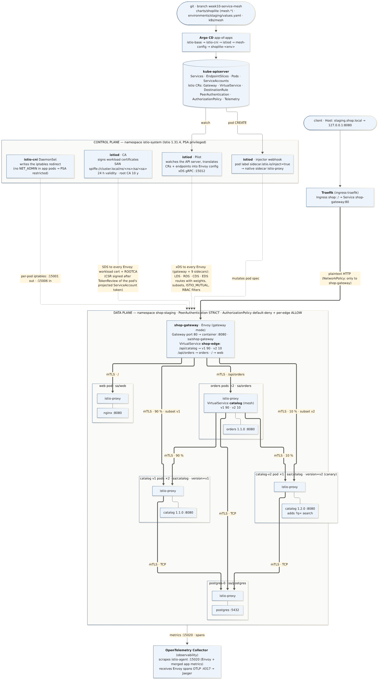
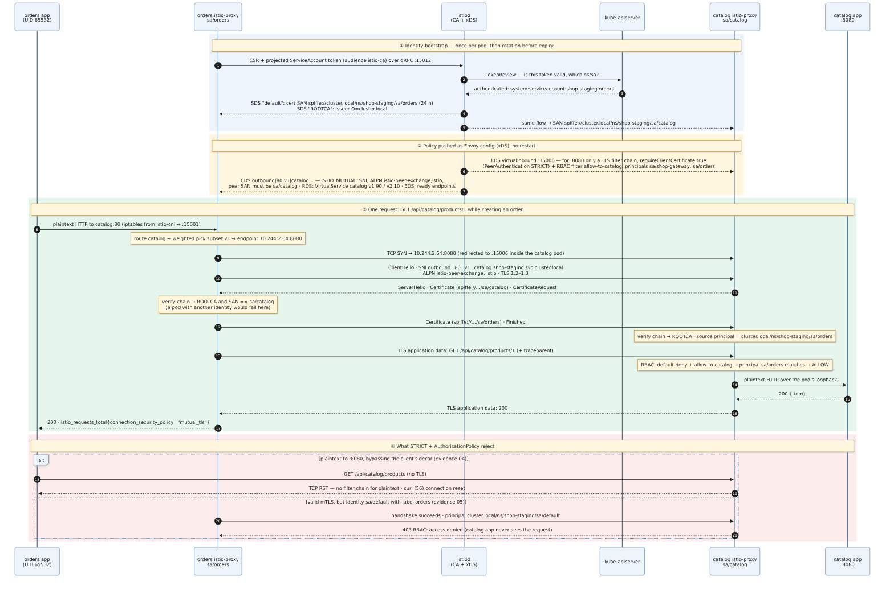
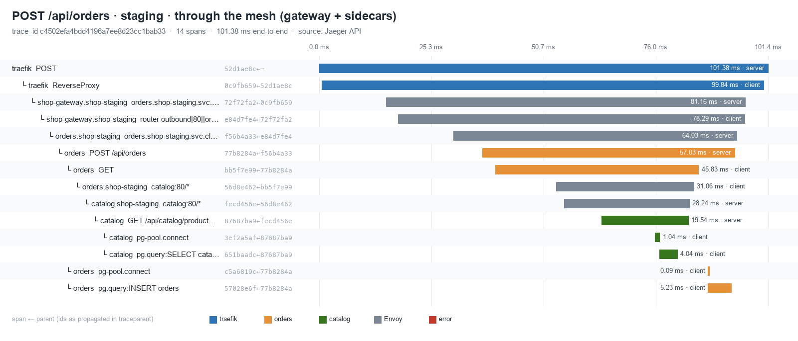

# Week 10 (Lab 6): Service Mesh Architecture & Inter-Service Communication

Word version of this report: [`Week10-Lab6-Report.docx`](Week10-Lab6-Report.docx). Architecture decisions: [`adr.md`](adr.md).

**System:** ShopLite from Weeks 7–9 (Traefik → `web`, `catalog`, `orders` → PostgreSQL, with the Week 9 telemetry pipeline) in three GitOps environments on the kind cluster.

This week puts the services into an **Istio 1.31.4 service mesh** (Envoy sidecars):
- traffic management moves out of the apps and the Ingress into Envoy, configured by Istio custom resources;
- every hop between services becomes **mutual TLS** with a per-workload SPIFFE identity;
- access is decided by that identity, not by IP addresses or pod labels;
- a new `catalog` version is released as a **90 / 10 canary**.

Everything is delivered the Week 8 way, as commits that Argo CD syncs. prod keeps its manual approval gate.

| Deliverable (from the assignment) | Where it is |
|---|---|
| Control/Data Plane Architecture Diagram (control plane injecting routing rules into the Envoy sidecars) | [§2](#2-control-plane-vs-data-plane) · [`diagrams/mesh-topology.mmd`](diagrams/mesh-topology.mmd) |
| mTLS Handshake Sequence Diagram (ServiceAccount identities, PeerAuthentication) | [§4](#4-zero-trust-transport-mtls) · [`diagrams/mtls-handshake-sequence.mmd`](diagrams/mtls-handshake-sequence.mmd) |
| Istio CRD manifest files (VirtualService, DestinationRule, Gateway, PeerAuthentication, …) | [§3](#3-istio-resources-and-traffic-rules) · [`manifests/`](manifests/), rendered from the source of truth [`charts/shoplite/templates/mesh.yaml`](../../charts/shoplite/templates/mesh.yaml) and [`k8s/mesh/`](../../k8s/mesh/) |
| Mesh topology: service discovery, traffic splitting, encrypted transport | [§2](#2-control-plane-vs-data-plane), [§3](#3-istio-resources-and-traffic-rules), [§4](#4-zero-trust-transport-mtls) |
| Explicit traffic-shifting rules (canary 90 % v1 / 10 % v2) | [§3.2](#32-traffic-shifting-rules-canary-9010) · [§6](#6-canary-validation) |
| Validation of mTLS and traffic distribution with istioctl | [§7](#7-istioctl-diagnostics) · [`evidence/`](evidence/) |

---

## 1. Requirements → design

| Requirement | Design decision |
|---|---|
| Decentralized traffic management | Every pod gets an Envoy sidecar (native sidecar, injected by istiod). Routing, retries, timeouts and load balancing run in the **caller's** proxy, configured by istiod through xDS. Apps keep calling plain `http://catalog` ([ADR-W10-01](adr.md#adr-w10-01--istio-in-sidecar-mode-installed-by-argo-cd-from-the-official-helm-charts)). |
| Service discovery | istiod watches Kubernetes Services and EndpointSlices and pushes them as Envoy clusters (CDS) and endpoints (EDS). Only *ready* endpoints are pushed. With `outboundTrafficPolicy: REGISTRY_ONLY`, a host outside the registry goes nowhere. |
| North-south entry | One Envoy **gateway per environment** behind Traefik: `Gateway` + `VirtualService shop-edge` ([ADR-W10-02](adr.md#adr-w10-02--one-envoy-ingress-gateway-per-environment-behind-traefik)). |
| Encrypted transport, zero trust | `PeerAuthentication` **STRICT** (mesh-wide default and per namespace). `DestinationRule` `ISTIO_MUTUAL`. Workload certificates are signed by istiod's CA, carry the ServiceAccount as a SPIFFE ID and last 24 h ([§4](#4-zero-trust-transport-mtls)). |
| Least privilege between services | `AuthorizationPolicy` default-deny + one ALLOW per call-graph edge, matched on **SPIFFE principal**. NetworkPolicies stay as a second, independent layer ([ADR-W10-05](adr.md#adr-w10-05--zero-trust-as-two-independent-layers-networkpolicy-labels--authorizationpolicy-identity)). |
| Canary 90 / 10 | `DestinationRule` subsets v1/v2 (pod label `version`), `VirtualService` weights at the edge **and** east-west. The split is independent of replica counts ([ADR-W10-06](adr.md#adr-w10-06--canary-by-weights-in-the-virtualservice-not-by-replica-count)). |
| Resilience at the proxy | `connectTimeout: 1s` (fixes the Week 9 finding of a 10 s TCP connect hang) and `outlierDetection` (eject an endpoint after 5 consecutive 5xx). |
| Observable mesh | Envoy metrics and app metrics merged on istio-agent `:15020`, Envoy spans into the Week 9 Collector, gateway access log ([ADR-W10-07](adr.md#adr-w10-07--mesh-telemetry-goes-into-the-week-9-pipeline)). |
| PSA "restricted" stays | `istio-cni` writes the iptables redirect, so no `NET_ADMIN` in app pods ([ADR-W10-03](adr.md#adr-w10-03--istio-cni-instead-of-the-istio-init-container)). |
| Safe rollout, prod behind approval | Phases PERMISSIVE → STRICT → canary, one commit each ([ADR-W10-04](adr.md#adr-w10-04--phased-rollout-permissive--strict--canary-prod-stays-at-phase-1-until-approved)). |

## 2. Control plane vs data plane



| Plane | Component | Role here |
|---|---|---|
| Control | **istiod** · Pilot | Watches the API server: Services, EndpointSlices, Pods and the Istio CRs. Translates them into Envoy listeners, routes, clusters and endpoints, and streams them over **xDS** (gRPC :15012) to every proxy. A change is pushed in seconds without restarting pods. |
| Control | **istiod** · CA | Signs a certificate for each proxy after validating the pod's projected ServiceAccount token (TokenReview). The certificate is delivered over **SDS** and rotated before its 24 h expiry. |
| Control | **istiod** · injector | Mutating webhook. A pod labelled `sidecar.istio.io/inject: "true"` (rendered by the chart) gets `istio-validation` + `istio-proxy` as native sidecars. `shop-gateway` gets the `gateway` template. |
| Control | **istio-cni** DaemonSet | Writes each pod's redirect: outbound → :15001, inbound → :15006. |
| Data | **shop-gateway** (Envoy) | Edge of each environment: Gateway port 80, `VirtualService shop-edge`. |
| Data | **istio-proxy** sidecar in every app pod | Outbound: routing, canary split, mTLS origination (checks the server's SAN). Inbound: mTLS termination (requires a client certificate), AuthorizationPolicy (RBAC filter), telemetry. |

Delivery is GitOps. Argo CD installs the control plane from the official charts in sync waves:
1. `istio-base` (CRDs);
2. `istio-cni` and `istiod`;
3. `mesh-config` (`k8s/mesh`);
4. the environment apps.

The chart renders the per-environment mesh objects ([`gitops/apps/mesh.yaml`](../../gitops/apps/mesh.yaml)). Control plane up: [`evidence/01`](evidence/01-control-plane-up.txt). State per environment: [`evidence/02`](evidence/02-rollout-phases.txt).

## 3. Istio resources and traffic rules

### 3.1 The resources

Rendered per environment by `scripts/mesh-export-manifests.sh` into [`manifests/`](manifests/). The files contain exactly what Argo CD applies:

| File | Resources |
|---|---|
| [`00-mesh-wide.yaml`](manifests/00-mesh-wide.yaml) (istio-system) | `PeerAuthentication default` **STRICT** (secure default for any namespace) · `Telemetry mesh-default` (Envoy tracing → Collector, 100 %) |
| [`shop-staging.yaml`](manifests/shop-staging.yaml) — 15 | `Gateway shop-gateway` · `VirtualService shop-edge` (gateway routes, canary) · `VirtualService catalog` (east-west canary) · `DestinationRule` catalog (subsets v1/v2), orders, web, postgres · `PeerAuthentication default` STRICT · `AuthorizationPolicy` default-deny, allow-to-{shop-gateway, web, orders, catalog, postgres} · `Telemetry gateway-access-log` |
| [`shop-dev.yaml`](manifests/shop-dev.yaml) — 14 | same, without the canary |
| [`shop-prod.yaml`](manifests/shop-prod.yaml) — 8 | phase 1: Gateway, VirtualService, DestinationRules, `PeerAuthentication` **PERMISSIVE**, no AuthorizationPolicy yet. **Not yet applied** (waits for approval). |

Common traffic policy in every DestinationRule:
- `tls.mode: ISTIO_MUTUAL`;
- `connectionPool.tcp.connectTimeout: 1s`;
- `outlierDetection`: 5 consecutive 5xx, checked every 10 s, ejection 30 s, at most 50 % ejected.

### 3.2 Traffic-shifting rules (canary 90/10)

The weights come from `services.catalog.canary.weight: 10` in [`environments/staging/values.yaml`](../../environments/staging/values.yaml). The chart helper `shoplite.meshRoute` renders `100 − w` / `w`.

```yaml
# DestinationRule catalog — who is v1 and who is v2 (pod label "version", set by the chart)
subsets:
  - { name: v1, labels: { version: v1 } }   # Deployment catalog     image 1.1.0, 2 replicas
  - { name: v2, labels: { version: v2 } }   # Deployment catalog-v2  image 1.2.0, 1 replica
---
# VirtualService catalog (gateways: [mesh]) — every sidecar that calls catalog, e.g. orders
http:
  - name: catalog-canary
    route:
      - { destination: { host: catalog.shop-staging.svc.cluster.local, subset: v1, port: { number: 80 } }, weight: 90 }
      - { destination: { host: catalog.shop-staging.svc.cluster.local, subset: v2, port: { number: 80 } }, weight: 10 }
---
# VirtualService shop-edge (gateways: [shop-gateway]) — the same split for /api/catalog at the edge,
# plus /api/orders → orders and / → web.
```

The split is applied in **both** places, so the canary sees the same share of external and internal traffic. Replica counts do not matter: 2 v1 pods vs 1 v2 pod still gives 90 / 10. The next steps are value changes:
- promote: `weight: 50`, then `100`, then move 1.2.0 to the stable `image.tag`;
- roll back: `canary.enabled: false`.

What istiod actually pushed to the gateway (`istioctl proxy-config route`):

```
/api/catalog → outbound|80|v1|catalog.shop-staging.svc.cluster.local = 90, outbound|80|v2|catalog.shop-staging.svc.cluster.local = 10
```

## 4. Zero-trust transport (mTLS)



The sequence uses the values observed in this cluster.

**Identity**
- Each workload runs as its own ServiceAccount, created by the chart with `automountServiceAccountToken: false`.
- The sidecar's istio-agent sends a CSR together with the pod's projected token (audience `istio-ca`). istiod validates the token with a TokenReview and signs the certificate.
- Certificate of a catalog pod ([`evidence/07`](evidence/07-istioctl-diagnostics.txt)):
  - SAN `URI:spiffe://cluster.local/ns/shop-staging/sa/catalog`;
  - issuer `O=cluster.local`;
  - valid Nov 11 10:53:29 → Nov 12 10:55:29 2026 (24 h);
  - root CA valid 10 years.

**Client side** (orders' cluster for catalog v1, `istioctl proxy-config cluster`):
- SNI `outbound_.80_.v1_.catalog.shop-staging.svc.cluster.local`;
- ALPN `istio-peer-exchange, istio`;
- the peer must present `spiffe://cluster.local/ns/shop-staging/sa/catalog`;
- TLS 1.2–1.3.

**Server side** (catalog's inbound listener :15006, filter chains for port 8080):
- PERMISSIVE: one chain for TLS and one for plaintext.
- **STRICT: only the TLS chain, with `requireClientCertificate: true`.** A plaintext connection matches no chain and is reset.

**On the wire:** `scripts/mesh-mtls-probe.sh` runs tcpdump in the catalog pod's network namespace from outside the cluster objects. It sends gateway traffic, an order (orders → catalog) and a plaintext request from an orders pod that bypasses its own sidecar (UID 1337).

| | PERMISSIVE (phase 1, [`evidence/03`](evidence/03-mtls-capture-permissive.txt)) | STRICT (phase 2, [`evidence/04`](evidence/04-mtls-capture-strict.txt)) |
|---|---|---|
| Mesh traffic | ClientHello (SNI `outbound_.80_._.catalog…`, ALPN `istio-http/1.1,istio,http/1.1`) → handshake → ChangeCipherSpec → encrypted application data | identical |
| Plaintext GET to :8080 | **readable on the wire**: `GET /api/catalog/products HTTP/1.1` → `HTTP/1.1 200 OK` | **RST from the catalog sidecar**, `curl: (56) Connection reset by peer` |
| Totals | 28 appdata · 24 handshake · 12 CCS · **2 plaintext** | 20 appdata · 10 handshake · 5 CCS · 1 plaintext request · **1 RST** |

The captures were taken before the canary existed, so the SNI has no subset (`_._`). After phase 3, the subset appears in the SNI (`…_.v1_.…`).

## 5. Identity-based authorization

The authorization policies:
- `default-deny` blocks everything;
- each ALLOW names the callers by SPIFFE principal (`allow-to-catalog`: `sa/shop-gateway` and `sa/orders`, port 8080; `allow-to-postgres`: `sa/catalog` and `sa/orders`).

`scripts/mesh-authz-probe.sh` proves that a pod **label** is not an identity ([`evidence/05`](evidence/05-authz-identity-probe.txt)).

| Caller | NetworkPolicy (labels) | Certificate SAN | Result |
|---|---|---|---|
| impostor pod labelled `app.kubernetes.io/name=orders`, ServiceAccount `default` | allowed | `spiffe://cluster.local/ns/shop-staging/sa/default` | **403 `RBAC: access denied`** from catalog's sidecar. The app never sees the request. |
| real orders pod | allowed | `spiffe://cluster.local/ns/shop-staging/sa/orders` | **200** |

The impostor's readiness probe always fails, so it never joins the orders Service's endpoints and cannot receive real traffic.

Per-request view from the catalog sidecar's own metrics (`istio_requests_total` by `source_principal`):

```
spiffe://cluster.local/ns/shop-staging/sa/default       code 403  mutual_tls     1 requests
spiffe://cluster.local/ns/shop-staging/sa/orders        code 200  mutual_tls   304 requests
spiffe://cluster.local/ns/shop-staging/sa/shop-gateway  code 200  mutual_tls  1884 requests
unknown                                                 code 200  none           4 requests   ← the PERMISSIVE-phase plaintext probes
```

## 6. Canary validation

`scripts/mesh-canary-check.sh staging 1000 400` counts the split three independent ways ([`evidence/06`](evidence/06-canary-traffic-split.txt)).

The first count needs to tell the versions apart from the response alone. catalog 1.2.0 adds `?q=` search; 1.1.0 ignores the parameter. So `GET /api/catalog/products?q=zzz-canary-probe` returns **all products from v1 and `[]` from v2**: a behaviour difference the user would see, not a debug header.

| Count | v1 | v2 | v2 share |
|---|---|---|---|
| 1. Client side, 1000 × GET through Traefik → gateway | 881 | 119 | **11.9 %** (95 % Wilson interval 10.0–14.1 %, contains 10 %) |
| 2. Gateway access log, upstream cluster per request | 881 × `outbound\|80\|v1\|catalog…` | 119 × `…\|v2\|…` | 11.9 % (identical to 1) |
| 3a. Envoy metrics in Prometheus, gateway → catalog | 1194 | 161 | 11.9 % · all `mutual_tls` |
| 3b. Envoy metrics, **orders → catalog** (400 orders, east-west) | 491 | 52 | **9.5 %** · all `mutual_tls` |

All 1000 requests returned 200 and all 400 orders 201. Envoy picks a weighted cluster per request at random, so with N = 1000 a ±2-point deviation is expected noise. Both shares are consistent with 10 %.

## 7. istioctl diagnostics

`scripts/mesh-diagnose.sh staging` ([`evidence/07`](evidence/07-istioctl-diagnostics.txt)):

| Check | Command | Result |
|---|---|---|
| Every proxy in sync with istiod | `istioctl proxy-status` | 16 proxies (14 dev + staging pods, 2 gateways), all 1.31.4, CDS/LDS/EDS/RDS subscribed |
| Configuration valid | `istioctl analyze -n shop-staging` | No errors or warnings. Info IST0102: injection is by pod label, not namespace label, which is intentional. The first run found IST0144 and IST0162, now fixed (ADR-W10-02). |
| Injection decision | `istioctl x check-inject deployment/<d>` | ✔ for catalog, orders, web and shop-gateway: "Pod label sidecar.istio.io/inject=true matches" |
| What applies to the canary pod | `istioctl x describe pod catalog-v2-…` | subset v2 of DestinationRule catalog; route weight **10 %**; workload mTLS mode **STRICT** |
| mTLS origination per subset | `istioctl proxy-config cluster … --fqdn catalog…` | SNI, ALPN, required peer SAN `sa/catalog`, SDS cert `default`, TLS 1.2–1.3, connectTimeout 1s, outlierDetection |
| Endpoints per subset | `istioctl proxy-config endpoint --cluster 'outbound\|80\|v1\|…'` | v1: 2 healthy endpoints · v2: 1 healthy endpoint |
| Certificates | `istioctl proxy-config secret` | `default` (24 h) and `ROOTCA` ACTIVE · SAN `spiffe://…/sa/catalog` |
| Inbound requires client cert | `istioctl proxy-config listener --port 15006` | port 8080: only `transport tls`, `requireClientCertificate True` |
| Gateway routes | `istioctl proxy-config route … --name http.8080` | `/api/orders*`, `/api/catalog*`, `/*` from VirtualService shop-edge. The `-o json` form shows the weighted clusters v1 = 90, v2 = 10 ([`evidence/06`](evidence/06-canary-traffic-split.txt)). |
| Authorization in effect | `istioctl x authz check catalog-…` | `default-deny` and `allow-to-catalog` both attached. An ALLOW policy that matches nothing switches the workload to deny-by-default; allow-to-catalog then admits sa/shop-gateway and sa/orders. |

## 8. GitOps rollout

| Step | Commit | Result |
|---|---|---|
| 0 Control plane | `894da3c`: Applications istio-base, istio-cni, istiod, mesh-config; AppProject `mesh`; Application health check; chart 0.3.0 with `mesh.enabled: false`; Collector scrapes pod IP + annotated port | Healthy in 36 s ([`evidence/01`](evidence/01-control-plane-up.txt)) |
| 1 Into the mesh, PERMISSIVE | `128048e`: `mesh.enabled: true` in dev, staging **and prod** (prod: PERMISSIVE, no authz, 2 gateway replicas) | dev and staging rolled with sidecars. **prod: OutOfSync, waiting for approval** ([`evidence/02`](evidence/02-rollout-phases.txt)) |
| 2 STRICT + authorization | `5a17706`: dev, staging | Applied through xDS in about 40 s, with no restarts ([`evidence/04`](evidence/04-mtls-capture-strict.txt), [`05`](evidence/05-authz-identity-probe.txt)) |
| 3 Canary | `d6be3fc`: staging, catalog 1.2.0 at 10 % | [`evidence/06`](evidence/06-canary-traffic-split.txt) |
| 4 Fixes from istioctl | `e1d83c2`: gateway port 80 → 8080, UID 1337 on the container only | `istioctl analyze` clean ([`evidence/07`](evidence/07-istioctl-diagnostics.txt)) |

**prod:** in this session the prod sync was not approved, so prod still runs the Week 9 release without sidecars. The operator approves it with `./scripts/gitops-sync-prod.sh`, which shows the diff and then syncs. Phase 2 for prod, and a prod canary if wanted, follow as separate commits behind the same gate.

**CI** ([`evidence/09`](evidence/09-ci-gates.txt)):
- With the mesh, the chart renders Istio CRs that plain kubeconform has no schema for (37 errors). G2 now validates them against the datree CRD catalog (123/123 valid) and validates `k8s/mesh`.
- G7 `trivy config` passes for the repo and for all three rendered environments with no new ignore entries.

## 9. Evaluation: design vs. observed

### 9.1 What matched the design

| Design expectation | Observed | ✓ |
|---|---|---|
| All service-to-service traffic is mTLS under STRICT | Capture shows only TLS on :8080. Every request in `istio_requests_total` to catalog is `mutual_tls`. | ✓ |
| Plaintext is refused under STRICT, accepted under PERMISSIVE | 200 and readable on the wire → RST | ✓ |
| Identity, not labels, decides access | Label-forging pod gets 403, real orders gets 200 | ✓ |
| 90 / 10 split at the edge and east-west | 11.9 % (CI contains 10 %) and 9.5 % | ✓ |
| Policy changes need no restarts | Phase 1 → 2 in about 40 s, no restarts | ✓ |
| One trace through gateway, sidecars and apps | 14-span trace: Traefik → shop-gateway → orders sidecar → orders → orders sidecar (`outbound\|80\|v1\|catalog`) → catalog sidecar → catalog → pg ([`evidence/08`](evidence/08-trace-through-mesh.txt), [waterfall](diagrams/trace-waterfall-mesh.png)) | ✓ |
| Week 9 observability unaffected | 51/53 Week 9 checks pass; the 2 failures are expected ([`evidence/10`](evidence/10-week9-telemetry-regression.txt)) | ✓ |
| App namespaces stay PSA restricted | Yes, through istio-cni | ✓ |



### 9.2 What the rollout revealed

1. **`istioctl analyze` caught two real errors in the first gateway version.**
   - IST0162: the Gateway's port 8080 was not a Service port.
   - IST0144: the gateway pod set UID 1337, which is reserved for Envoy, at pod level. `analyze` rejects this because in an ordinary workload it would put the app under Envoy's UID, which traffic capture exempts, so the app's traffic would bypass the sidecar. The UID is now set on the gateway's `istio-proxy` container only.
   - Fixed in `e1d83c2`.
2. **The Week 9 scrape broke by design under STRICT.** A plaintext scrape of :8080 is the same thing as the plaintext probe and gets reset. The Collector now scrapes istio-agent's merged endpoint (`:15020`) and builds the target from pod IP + annotated port (ADR-W10-07).
3. **Argo CD app-of-apps sync waves did not wait** until the Application health check was restored. Without it, istiod raced the CRDs (ADR-W10-01).
4. **The data plane costs more memory than the apps:** 16 proxies use 616 MiB (34–52 MiB each) against 473 MiB for the 14 app containers they serve ([`evidence/11`](evidence/11-sidecar-overhead.txt)). This is the main cost of the sidecar pattern on a small cluster, and the argument for ambient mode later.
5. **Latency per hop.** In the recorded trace, orders → catalog takes 31 ms as seen by the orders sidecar, against 19.5 ms inside catalog. It is a single trace on a kind cluster with 100 % tracing, so it is an indication, not a benchmark.
6. **Which label to query.** `destination_workload` splits catalog into `catalog` / `catalog-v2`. Canary queries must use `destination_canonical_service` together with `destination_version`.

## 10. Reproduce

```bash
export ISTIOCTL_DIR=<dir with istioctl 1.31.4>          # or put istioctl on PATH
# root app tracks week10-service-mesh (gitops/bootstrap); Argo CD installs Istio, then the apps
kubectl -n observability port-forward svc/prometheus 9090 &
kubectl -n observability port-forward svc/jaeger 16686 &
./scripts/mesh-mtls-probe.sh staging                    # tcpdump in catalog's netns: TLS vs plaintext
./scripts/mesh-authz-probe.sh staging                   # impostor (sa/default) → 403, orders → 200
./scripts/mesh-canary-check.sh staging 1000 400         # client / access log / Prometheus counts
./scripts/mesh-diagnose.sh staging                      # istioctl proxy-status, analyze, proxy-config, authz
./scripts/mesh-export-manifests.sh                      # docs/week10/manifests
./scripts/render-diagrams.sh                            # Mermaid + Pillow diagrams
./scripts/gitops-sync-prod.sh                           # operator only: approve the prod release (phase 1)
```

## 11. Limitations

- **prod is not meshed yet.** Phase 1 is in git and waits for the operator's approval (§8).
- **One istiod replica.** If it is down, proxies keep their last config and certificates remain valid for up to 24 h, but new pods cannot start (no injection) and config changes do not propagate. Production would run 2+ replicas with a PDB.
- **Self-signed mesh CA.** istiod generated its root (`O=cluster.local`). Production would plug in an intermediate from an external CA (cert-manager / Vault) so that the root key does not live in a cluster Secret.
- **No egress gateway.** `REGISTRY_ONLY` blocks unknown hosts at the sidecar, but there is no audited egress point. Nothing in ShopLite calls out today.
- **The Collector is outside the mesh.** It scrapes `:15020` in plaintext (metrics only, restricted by NetworkPolicy), and sends OTLP to Jaeger without mTLS.
- **The canary is promoted by hand** (values commits). Automated analysis (Argo Rollouts or Flagger with the §6 Prometheus query as the success metric) is the next step.
