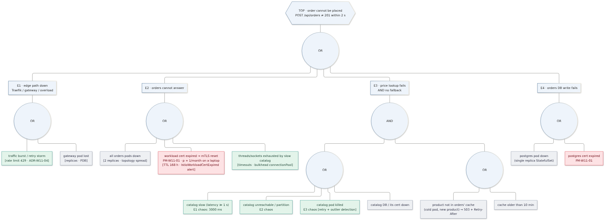
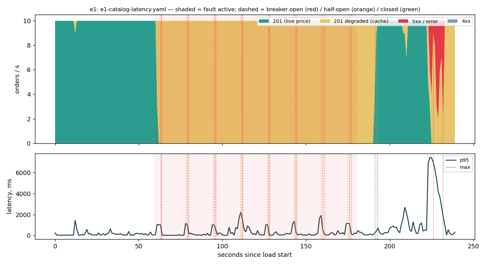

# Week 11 (Lab 7): System Resilience Patterns & Fault Tree Analysis

Word version of this report: [`Week11-Lab7-Report.docx`](Week11-Lab7-Report.docx). Architecture decisions: [`adr.md`](adr.md).

**System:** ShopLite from Weeks 7–10 (Traefik → per-environment Envoy gateway → `web`, `catalog`, `orders` → PostgreSQL, all in an Istio mesh with STRICT mTLS) in three GitOps environments on the kind cluster.

This week asks how ShopLite fails and makes it fail well:
- a **failure-mode analysis** (FMEA) and a **fault tree** for the most important user action, placing an order;
- **resilience patterns** where the analysis says they pay off: circuit breaker, retry with exponential backoff and jitter, fallback, timeouts, bulkhead, rate limiter;
- **chaos experiments** with Chaos Mesh that state a hypothesis, inject the fault under load and check the hypothesis automatically;
- **post-mortems**. One is for a chaos experiment. The other is for a *real* outage of dev and staging, found on the first day of this lab before any change was made.

| Deliverable (from the assignment) | Where it is |
|---|---|
| Circuit Breaker State Machine diagram (Closed / Open / Half-Open, trip thresholds, reset timeouts) | [§4.1](#41-circuit-breaker) · [`diagrams/circuit-breaker.mmd`](diagrams/circuit-breaker.mmd) |
| Fault Tree Analysis chart | [§3.2](#32-fault-tree) · [`diagrams/fault-tree.mmd`](diagrams/fault-tree.mmd) |
| Failure-mode analysis; resilience patterns: Circuit Breaker, Rate Limiter, Retry with Exponential Backoff | [§3.1](#31-fmea) · [§4](#4-resilience-patterns) |
| Chaos hypothesis ("3000 ms latency in Service B triggers the breaker and returns a cached fallback") | [§6.1](#61-e1--3000-ms-latency-in-catalog-the-assignments-hypothesis) |
| Resilience proxy rule (Envoy / Istio) | [§4.4](#44-mesh-rules-timeouts-safe-retries-bulkhead) · [§4.5](#45-rate-limiter-at-the-gateway) · [`charts/shoplite/templates/resilience.yaml`](../../charts/shoplite/templates/resilience.yaml) |
| Chaos experiment spec (YAML) | [`k8s/chaos/experiments/`](../../k8s/chaos/experiments/) (Chaos Mesh `NetworkChaos`, `PodChaos`) |
| Post-Mortem Report | [§7](#7-post-mortem-pm-w11-02--chaos-experiment-e1) (experiment) · [§2](#2-incident-pm-w11-01--expired-workload-certificates) (real incident) |

---

## 1. Requirements → design

| Requirement | Design decision |
|---|---|
| Know how the system fails before adding patterns | FMEA of the order path, ranked by RPN, and a fault tree with AND/OR gates for "order cannot be placed" (§3). Patterns go only where a failure mode is likely *and* harmful. |
| Circuit breaker | In **orders**, around the catalog call: closed / open / half-open, count-based window, per-pod state. Business fallback = last-known-good product from a cache ([ADR-W11-01](adr.md#adr-w11-01--circuit-breaker-and-fallback-in-the-application-transport-resilience-in-the-mesh)). |
| Retry with exponential backoff | In orders, for the idempotent GET to catalog only. Full jitter, 3 attempts, no retry on timeout. In the mesh, only for failures where the request never reached the app (ADR-W11-03). |
| Rate limiter | Envoy local rate limit at each environment's gateway, 429 above the token bucket ([ADR-W11-04](adr.md#adr-w11-04--rate-limiting-at-the-environments-gateway-with-envoys-local-rate-limit)). |
| Chaos experiment with Chaos Mesh / LitmusChaos | Chaos Mesh 2.8.8 via Argo CD, allowed only in namespaces annotated for it, so never in prod ([ADR-W11-02](adr.md#adr-w11-02--chaos-mesh-installed-by-argo-cd-allowed-only-in-dev-and-staging)). A runner applies the fault under load, records every second, and checks the hypothesis. |
| Observability of the patterns | Breaker state, transitions, rejected calls, fallbacks and retries as Prometheus metrics. Alert `CircuitBreakerOpen` with a promtool test. |
| GitOps as before | Every change is a commit on `week11-resilience` that Argo CD syncs to dev and staging. prod is untouched and still waits for its approval. |

## 2. Incident PM-W11-01 — expired workload certificates

The first look at the cluster for this lab (2026-11-26, after ~10 days away) showed **dev and staging down**: every request through the edge returned 503. prod, which is not yet in the mesh (Week 10, ADR-W10-04), answered 200. All of this was captured read-only before any change ([`evidence/00`](evidence/00-incident-expired-workload-certs.txt)).

**Summary.** Every Envoy sidecar in `shop-dev` and `shop-staging` held an expired workload certificate (24 h lifetime, expired 2026-11-25 between 01:44 and 11:39 UTC). STRICT mTLS refuses an expired certificate, so every *new* connection between sidecars was reset. Readiness probes open a new database connection, so catalog and orders pods went unready, and the gateway had no healthy endpoints: **503 for every request, for about 36 hours**. Nobody was paged, because no alert existed.

**Impact.** dev and staging unavailable from about 2026-11-25 01:44 UTC until the fix at 2026-11-26 13:23 UTC. No data loss. prod not affected.

**Timeline (UTC)**
| Time | Event |
|---|---|
| 11-16 12:14 | catalog pod renews its certificate (normal; expected every ~12 h, at 50 % of 24 h) |
| 11-18 → 11-24 | renewals arrive after +36 h, +45 h, +71 h and +39 h, all beyond the 24 h lifetime. Twice the certificate expired and healed itself hours later when the timer fired ([`evidence/01`](evidence/01-cert-expiry-in-prometheus.txt)) |
| 11-25 01:44 | postgres' certificate in staging expires; by 11:39 every other sidecar's has too. Not renewed this time |
| 11-26 13:14 | found: catalog `/readyz` 503, a new pg connection from inside the pod fails with `ECONNRESET` after 19 ms |
| 11-26 13:16 | evidence captured: certificate validity of every sidecar, edge status codes, istiod's timer gaps |
| 11-26 13:20 | fix committed (cb89d1b): `SECRET_TTL` 168 h + two alerts. Argo CD synced, dev/staging workloads restarted |
| 11-26 13:23 | every sidecar holds a certificate valid until 12-03; all edge checks return 200 ([`evidence/02`](evidence/02-recovery-after-ttl-fix.txt)) |

**Root cause — 5 whys**
1. *Why 503?* The gateway had no ready endpoints: catalog/orders failed their readiness probe.
2. *Why unready?* `/readyz` opens a new PostgreSQL connection, and the sidecar's mTLS handshake to postgres was refused.
3. *Why refused?* Both sidecars' certificates had expired and STRICT mTLS validates the validity period.
4. *Why expired?* istio-agent schedules the renewal on a timer, and that timer runs on the monotonic clock. The kind nodes live in Docker Desktop's VM, which is suspended while the laptop sleeps. The timer stops, but wall-clock time — and the certificate's `notAfter` — does not. istiod's own hourly check shows the same pattern: 19 gaps of 2–28 h in 10 days.
5. *Why did nobody notice?* `istio_agent_cert_expiry_seconds` was in Prometheus since Week 10 (−35 h at discovery), but no alert rule used it. The Week 9 alerts look at RED metrics, and an environment with no traffic produces no errors.

**What went well**
- prod was unaffected: the phased mesh rollout kept it out of the blast radius.
- The evidence was enough to find the cause in minutes: Envoy's `/certs` admin endpoint, istio-agent logs, Prometheus.

**What went wrong**
- The mesh was operated on defaults that assume a host that never sleeps.
- Monitoring had the signal but no alert.

**Action items**
| # | Action | Status |
|---|---|---|
| A1 | Workload certificate lifetime 24 h → **168 h** (`meshConfig.defaultConfig.proxyMetadata.SECRET_TTL`) | done (cb89d1b) |
| A2 | Alerts `IstioWorkloadCertExpiring` (< 25 % of lifetime left, ticket) and `IstioWorkloadCertExpired` (≤ 0, page), with a promtool test replaying the incident | done ([`tests/mesh-certificates.rules.test.yml`](../../k8s/observability/config/tests/mesh-certificates.rules.test.yml)) |
| A3 | Restart dev/staging workloads to get new certificates | done |
| A4 | Before approving the mesh for prod (Week 10, phase 2): run the cluster on a host that does not sleep, or keep the alert routed to a human | open |

## 3. Failure-mode analysis

### 3.1 FMEA

The order path: client → Traefik → `shop-gateway` → `orders` → (`catalog` → its DB) → orders DB. Scores are 1–10:
- **S** — severity for the customer;
- **O** — occurrence, how likely on this platform;
- **D** — detection, how *hard* it is to detect (10 = invisible).

RPN = S × O × D. The "after" column is the RPN with this week's mitigation and the measured result.

| # | Failure mode | Effect on the order | S | O | D | RPN | Mitigation (Week 11) | RPN after |
|---|---|---|---|---|---|---|---|---|
| F1 | catalog slow (GC pause, DB lock, CPU throttling) | every order waits; orders' workers pile up; 502 after 2 s | 7 | 6 | 5 | **210** | timeout 1 s, circuit breaker, cache fallback, bulkhead (E1) | 7·6·2 = 84; S→3 (degraded 201): **36** |
| F2 | workload certificate expired (PM-W11-01) | whole environment 503 | 9 | 5 | 9 | **405** | TTL 168 h, expiry alerts | 9·2·2 = **36** |
| F3 | catalog unreachable (partition, all pods down) | 502 for every order | 8 | 3 | 4 | 96 | breaker + cache fallback; 503 + Retry-After on cache miss (E2) | 4·3·2 = **24** |
| F4 | one catalog pod dies | a few failed requests during endpoint update | 5 | 6 | 3 | 90 | 2 replicas, transport retry on connect-failure, outlier detection (E3) | 2·6·2 = **24** |
| F5 | traffic burst / retry storm | all services saturated, everyone slow | 7 | 3 | 5 | 105 | gateway rate limit (429), no stacked retries (≤ 6 attempts, not 9) | 3·3·3 = **27** |
| F6 | orders → catalog retry amplification (app × mesh) | catalog overloaded exactly when weakest | 6 | 4 | 7 | 168 | explicit mesh retry policy (only connect-failure, 1 retry), app retry without timeouts, jitter | 6·2·4 = **48** |
| F7 | postgres (single replica) down | orders cannot be stored | 9 | 2 | 3 | 54 | not mitigated this week (StatefulSet with 1 replica; Week 13 looks at the DB) | 54 |
| F8 | orders accepts an order with a stale cached price | wrong price on a degraded order | 4 | 3 | 6 | 72 | order flagged `degraded`, cache TTL 10 min, metric `dependency_fallback_total` | 4·3·2 = **24** |

The two highest RPNs were the slow dependency (F1), which is what the assignment's chaos hypothesis is about, and the certificate expiry (F2). F2 was the one that actually happened.

### 3.2 Fault tree

TOP event: *a customer cannot place an order* (POST `/api/orders` is not 201 within 2 s). An OR gate fails if any input fails, an AND gate only if all inputs fail. The design idea of this week is the **AND gate under E3**. A catalog failure only reaches the customer if there is *also* no fallback. Before Week 11 that branch was a plain OR.



Minimal cut sets, i.e. the smallest sets of basic events that cause the TOP event:
- single points of failure, order-1 cut sets: postgres down (B10), certificate expired (B4/B11), all orders pods down (B3), gateway down (B2), rate limit exhausted by legitimate traffic (B1);
- order-2 cut sets created this week: {catalog slow/unreachable/killed} × {product not cached / cache older than 10 min}. Each needs two independent events, so each is much less likely than the order-1 set it replaced.

## 4. Resilience patterns


### 4.1 Circuit breaker


- Implementation: [`services/orders/src/circuit-breaker.js`](../../services/orders/src/circuit-breaker.js), unit-tested with a fake clock in [`test/circuit-breaker.test.js`](../../services/orders/test/circuit-breaker.test.js).
- Trip thresholds: ≥ 50 % failures in the last 20 calls (at least 10 calls), or 5 consecutive failures.
  - The consecutive rule trips faster when the dependency dies suddenly. In E1 it decided both trips.
  - The rate rule catches a dependency that fails half the time.
- What counts as a failure: a timeout, a connection error or a 5xx. A 404 ("no such product") and other 4xx are answers, not failures.
- Reset timeout: 15 s open, then half-open with at most 3 trial calls. Calls beyond those 3 are rejected and get the fallback. One failed trial re-opens the breaker and restarts the 15 s.
- Every transition is logged (`orders: circuit catalog closed → open (5 consecutive failures)`) and counted (`circuit_breaker_transitions_total`). The current state is a gauge (`circuit_breaker_state`: 0 / 1 / 2).

### 4.2 Retry with exponential backoff and full jitter

- [`services/orders/src/retry.js`](../../services/orders/src/retry.js): `sleep = random(0, min(500 ms, 50 ms · 2^attempt))`, 3 attempts in total.
- Full jitter instead of a fixed backoff: when catalog recovers, the retries of all orders pods do not arrive in one synchronized wave.
- Retried: connection errors, 502/503/504, on the idempotent GET only.
- **Not** retried:
  - timeouts — a slow catalog would get twice the load, and the user would wait twice as long; that case is the breaker's;
  - `CircuitOpenError` — the breaker already decided;
  - 4xx.

### 4.3 Fallback and graceful degradation

| Situation | Before (orders 1.1.0) | After (orders 1.2.x) |
|---|---|---|
| catalog slow | waits 2 s, then **502** | waits ≤ 1 s, then **201** from the cache with `degraded: true`, `X-Degraded: timeout`; once the breaker is open: **201 in a few ms** (`X-Degraded: circuit_open`) |
| catalog unreachable, product seen before | **502** | **201** degraded |
| catalog unreachable, product never seen by this pod | **502** | **503** + `Retry-After: <seconds until half-open>` — a retryable status with a hint, instead of a generic error |
| unknown product (catalog answers 404) | 422 | 422 (an answer, not a failure: does not trip the breaker) |

### 4.4 Mesh rules: timeouts, safe retries, bulkhead

Rendered by the chart from `mesh.routes` and `mesh.trafficPolicy` ([`templates/mesh.yaml`](../../charts/shoplite/templates/mesh.yaml)). The live objects are in [`evidence/06`](evidence/06-deployed-resilience-config.txt).

```yaml
# VirtualService catalog (east-west) and every route of VirtualService shop-edge
timeout: 10s
retries:
  attempts: 1
  perTryTimeout: 5s
  retryOn: connect-failure,refused-stream   # the request never reached the app → safe for POST
# DestinationRule <service> — bulkhead per calling sidecar
trafficPolicy:
  connectionPool:
    tcp:  { connectTimeout: 1s }
    http: { http1MaxPendingRequests: 32, http2MaxRequests: 64, maxRetries: 3 }
  outlierDetection: { consecutive5xxErrors: 5, interval: 10s, baseEjectionTime: 30s, maxEjectionPercent: 50 }
```

Before this week, orders → catalog had no VirtualService (except during the canary), so Istio's *default* retry policy applied: 2 retries, also on 503. With the new app retry that would have been up to 3 × 3 = 9 requests per order to a struggling catalog. Now it is at most 3 × 2, and the mesh retries only connection failures ([ADR-W11-03](adr.md#adr-w11-03--mesh-retries-only-where-the-request-never-reached-the-app-bulkhead-per-caller)).

### 4.5 Rate limiter at the gateway

An `EnvoyFilter` adds Envoy's local rate limit filter to `shop-gateway`. It is a token bucket per gateway pod: 200 tokens, refilled with 100 per second ([`templates/resilience.yaml`](../../charts/shoplite/templates/resilience.yaml)). The probe [`scripts/ratelimit-probe.py`](../../scripts/ratelimit-probe.py) gave these results ([`evidence/04`](evidence/04-ratelimit-probe.txt)):

| Phase | Requests | 200 | 429 |
|---|---|---|---|
| Burst, 1000 requests in 1.3 s (≈ 770 req/s) | 1000 | 325 | 675 |
| Steady 50 req/s for 10 s (below the refill rate) | 500 | 500 | 0 |

- 325 = the 200 tokens in the bucket plus ~130 refilled during the 1.3 s.
- The 675 rejected requests were answered by the gateway itself (`server: istio-envoy`, `x-local-rate-limit: true`, `retry-after: 1`) and never reached catalog.

## 5. Chaos engineering setup

- **Platform.** Chaos Mesh 2.8.8 is installed by Argo CD as Application `chaos-mesh` in its own AppProject. It has 1 controller and one chaos-daemon per worker node, on the containerd runtime ([`evidence/05`](evidence/05-chaos-mesh-install.txt)).
- **Blast radius.** `enableFilterNamespace: true`, so only namespaces annotated `chaos-mesh.org/inject: enabled` (`shop-dev`, `shop-staging`) can be targeted. `shop-prod` has no annotation.
- **Experiments as code.** The YAML is in [`k8s/chaos/experiments/`](../../k8s/chaos/experiments/), validated in CI against the Chaos Mesh CRD schemas. Argo CD does not sync them, because an experiment must not be restarted by a sync.
- **Runner** — [`scripts/chaos-experiment.py`](../../scripts/chaos-experiment.py), run for all three by [`scripts/chaos-run-all.sh`](../../scripts/chaos-run-all.sh):
  1. steady load: an open model, so slow answers do not slow the load down, `POST /api/orders` at 10/s through the staging edge;
  2. baseline 60 s → `kubectl apply` the fault → chaos window → `kubectl delete` → recovery 60 s;
  3. records every second: codes, degraded answers, p50/p95/max;
  4. collects breaker transitions from the orders logs and counters from Prometheus;
  5. checks the hypothesis (PASS/FAIL) and draws the timeline.

## 6. Chaos experiments

### 6.1 E1 — 3000 ms latency in catalog (the assignment's hypothesis)

**Hypothesis** ([`e1-catalog-latency.yaml`](../../k8s/chaos/experiments/e1-catalog-latency.yaml)):
> Injecting 3000 ms latency into catalog's answers to orders makes orders' circuit breaker open within 10 s. `POST /api/orders` keeps answering 201 from the last-known-good cache (flagged degraded) with p95 < 1.5 s and **0 % 5xx**. The breaker closes ≤ 30 s after the fault is removed.

- **Steady state:** 10 orders/s, 0 % 5xx, `circuit_breaker_state{name="catalog"} = 0`.
- **Fault:** `NetworkChaos` `delay` 3000 ms on packets from catalog pods (v1 ×2, v2 ×1) to orders pods only. The gateway → catalog and catalog → postgres paths are untouched.
- **Duration:** 120 s, then removed. **Abort:** delete the object (Chaos Mesh removes the tc rules).

E1 was run four times. Each rejected run found a different defect, the defect was fixed in a new orders release, and the experiment was re-run (§7). All runs are kept as evidence.

| Run (orders) | Baseline | During the fault (1200 orders) | Breaker opened after | Closed after removal | Verdict |
|---|---|---|---|---|---|
| [run 1](evidence/e1-catalog-latency-run1/summary.txt) (1.2.0) | 600 × 201 | 1198 × 201 (1185 degraded), **2 × 502**, p95 1015 ms | 3.0 s | 12.0 / 11.8 s | rejected: orders → **PostgreSQL** connect reset |
| [run 2](evidence/e1-catalog-latency-run2/summary.txt) (1.2.1) | 600 × 201, p95 354 ms | 1194 × 201, **6 × 503** (gateway `UO,UF`), p95 488 ms | 7.1 s | 15.6 / 15.5 s | rejected: host busy right after an image build, gateway → orders overflow before the trip |
| [run 3](evidence/e1-catalog-latency-run3/summary.txt) (1.2.1) | 600 × 201 | 1199 × 201, **1 × 503** (sidecar `UC`), p95 1013 ms | 2.2 s | 10.6 / 10.7 s | rejected: keep-alive race between Envoy and Node |
| [run 4](evidence/e1-catalog-latency-run4/summary.txt) (1.2.2) | 600 × 201 | **1200 × 201** (1187 degraded), **0 × 5xx**, p95 753 ms | 3.1 s | 11.0 / 12.8 s, then re-opened in a platform stall at t = 223 s | **confirmed for the fault window**; recovery errors caused by the platform (below) |



Reading the run 4 chart:
- **t = 60 s.** The fault starts. The first orders wait for the 1 s timeout, are served from the cache (yellow), and after 5 consecutive failures per pod the breakers open (t = 63 s).
- **Every 15 s.** A half-open probe: up to 3 orders per pod wait ~1 s for the trial call, which times out. The breaker re-opens. These probes are the latency spikes.
- **t = 180 s.** The fault is removed. The next probes succeed and the breakers close at t = 191/193 s. Live prices are back (green).
- **t = 223–232 s.** 43 errors (33 × 503, 10 × 504 `UT`) and 7 s latencies. This was 40 s *after* the recovery, and it was not caused by the experiment. In the same seconds the kube-apiserver, Traefik, Argo CD, Jaeger, the OTel Collector and pods in `shop-dev` failed their probes ([`evidence/07`](evidence/07-platform-stalls.txt)). The kind VM was CPU-starved: PSI `some cpu` = 38 % over 5 min, 8 vCPU for three meshed environments plus the platform. The breakers re-opened (correctly) during that stall, so the runner's check "closed again" reports *never*. They had closed 11–13 s after the fault was removed.

The breaker's own numbers in run 4 (Prometheus `increase()` over the run — extrapolated from 15 s scrapes, and including the stall at t = 223 s):
- 1324 calls **rejected** without touching catalog;
- 71 failures;
- 67 orders answered from the cache after a timeout, 1324 after the breaker refused the call;
- 3 retries (connection errors only; timeouts are not retried).

### 6.2 E2 — network partition orders ⇹ catalog

**Hypothesis** ([`e2-catalog-partition.yaml`](../../k8s/chaos/experiments/e2-catalog-partition.yaml)):
> With catalog unreachable from orders, orders answers within 1.5 s. Products it has seen get 201 degraded; a product it has never seen gets 503 + `Retry-After`, never a hang and never a 502.

During the 90 s partition the load also ordered product 4, which no orders pod had cached ([evidence](evidence/e2-catalog-partition/summary.txt), orders 1.2.0).

| Phase | Orders | Result |
|---|---|---|
| baseline | 600 | 598 × 201, **2 × 502** — a platform stall at t = 38 s, before the fault (the same DB-connect defect as E1 run 1, fixed in 1.2.1) |
| partition | 900 | 673 × 201 (669 degraded) for products 1–3: **0 errors**; 227 × **503 + Retry-After** for product 4; p95 41 ms after the first 10 s |
| recovery | 600 | 600 × 201 |

**Verdict: confirmed.**
- The breakers opened 2.1 s after the partition and closed 2.8 s and 8.5 s after it was removed.
- The 503s were all for the uncached product. None was a 502, and none took longer than 1.45 s.

### 6.3 E3 — one catalog pod killed

**Hypothesis** ([`e3-catalog-pod-kill.yaml`](../../k8s/chaos/experiments/e3-catalog-pod-kill.yaml)):
> Losing one catalog replica is invisible to users: 0 failed orders, and the breaker stays closed.

**Verdict: confirmed** ([evidence](evidence/e3-catalog-pod-kill/summary.txt)).
- 1500 orders, all 201, no breaker transition.
- During the minute after the kill, p95 rose to 1.7 s, and 11 orders were served from the cache: their catalog call hit the killed pod and timed out before the endpoint update reached orders' sidecar.
- The breaker counted these failures but they never reached its thresholds. That is the intended behaviour: a single bad pod is the job of the mesh (retry on connect-failure, outlier detection), not of the breaker.

## 7. Post-mortem PM-W11-02 — chaos experiment E1

**Summary.** The experiment written for the slow-catalog scenario confirmed what it was designed to test: the breaker opened within 2–7 s and orders kept selling from the cache. But it was **rejected three times** by failures on paths the design had not looked at. Each one was a latent defect that a real slowdown would have turned into customer-visible errors.

**Timeline (UTC, 2026-11-27)**
| Time | Event |
|---|---|
| 11:40 | Reading the live ConfigMap shows that orders 1.2.0 ran without its CB_*/RETRY_* settings and with a 2 s timeout. The values edit had missed the orders block (fixed in 0265435) — so the first round of experiments on 11-26 tested the code defaults, not the documented configuration. All experiments were repeated |
| 11:43 | **E1 run 1**: 2 × 502 during the fault. Traces show `pg-pool.connect` → `read ECONNRESET`, i.e. orders' *database* connection, not catalog |
| 11:48 | E2 baseline (no fault yet): 2 × 502 with `Connection terminated due to connection timeout` on the DB connect, at the same second as Warning events across all namespaces — a platform stall |
| 11:57 | **orders 1.2.1**: the PostgreSQL connect is retried (3 attempts, jittered). The query itself is never retried |
| 11:59 | **E1 run 2**: 0 × 502, but 6 × 503 `UO,UF` at the gateway during the 7 s before the breakers opened. The run started 30 s after an image build; baseline p95 was already 354 ms |
| 12:03 | **E1 run 3** on a quieter host: breakers open in 2.2 s, 1 × 503 with Envoy flag **`UC`** (upstream connection termination) inside orders' sidecar |
| 12:09 | **orders 1.2.2**: Node's HTTP keep-alive raised from 5 s to 61 min, above Envoy's 1 h idle timeout |
| 12:12 | **E1 run 4**: **0 errors in 1200 orders during the fault**. Errors 40 s after recovery coincide with a cluster-wide stall (kube-apiserver readiness 500) |

### 7.1 Root causes

| # | Defect | Why it was invisible before | Fix |
|---|---|---|---|
| R1 | Configuration not applied (orders ran on code defaults) | Helm rendered fine; the difference was only visible in the live ConfigMap | values fixed; evidence now captures the *live* config ([`evidence/06`](evidence/06-deployed-resilience-config.txt)) |
| R2 | A failed **DB connect** became a 502. The resilience work covered only the catalog call | The DB is "local" and never failed in Weeks 7–10. A new pool connection is opened only when concurrency rises — exactly when a dependency is slow | 1.2.1: retry the connect (safe: no SQL sent yet); idle connections kept 60 s instead of 10 s |
| R3 | **Keep-alive race**: Node closes idle connections after 5 s, Envoy reuses them for up to 1 h → 503 `UC` | Rare under steady load. The fault churns connections and makes it likely | 1.2.2: `server.keepAliveTimeout` 61 min, i.e. longer than the proxy's |
| R4 | Load shedding at the gateway before the breaker trips (503 `UO,UF`) | Appears only when orders is CPU-starved in the first seconds of the fault | not changed: this is the bulkhead doing its job; see A9 |
| R5 | **Platform stalls**: the kind VM is CPU-starved every few minutes | Weeks 7–10 never ran sustained load for minutes | not fixable in the lab; documented, separated from the results (A10) |

### 7.2 What the experiments revealed

- **The breaker protects one edge of the graph.** The order path also depends on PostgreSQL, the sidecars and the platform. E1 failed on each of them before it failed on the edge it was written for. A resilience review must cover every hop of the request, not only the one in the hypothesis.
- **The half-open probe has a price.** Every 15 s, up to 3 orders per pod wait the full per-attempt timeout (1 s) for the trial call. These spikes are the p95 of ~1 s in runs 1, 3 and 4. A background health probe, or a shorter timeout for trial calls only, would hide them from users.
- **Mesh and app must be configured together.**
  - Envoy's connect timeout (1 s) fires before the app timeout when *new* connections are delayed: the SYN-ACK is delayed too. The app then sees 503 `UF` instead of a timeout, and retries it.
  - Node's keep-alive must be longer than the sidecar's idle timeout.
  - These rules exist only because of the sidecar.
- **Metrics need to exist before the incident.** In the first run of 11-26, Prometheus' `increase()` reported 0 for `closed → open` because the counter series was created by that very transition. Recording-rule users should initialise label combinations at 0 (A8).

### 7.3 Action items

| # | Action | Owner / status |
|---|---|---|
| A5 | orders 1.2.1 — DB connect retry; 1.2.2 — keep-alive longer than the sidecar | done (d9414ae, cbdf163) |
| A6 | Export `http_local_rate_limiter.*` (gateway) through `proxyStatsMatcher`, so that 429s are visible in Prometheus | open |
| A7 | Same keep-alive rule for catalog (Node) and check nginx (`web`); catalog changes go with the Week 12 release | open → Week 12 |
| A8 | Initialise `circuit_breaker_transitions_total` label combinations at 0 | open |
| A9 | Half-open: probe with a shorter timeout (e.g. 300 ms) or out-of-band, so no user request pays for it | open |
| A10 | Chaos runs on a quiet host: give the kind VM more CPU, or scale `shop-dev` down while experimenting; the runner should record PSI and mark seconds with a platform stall | open |

## 8. Evaluation: design vs. observed

| Design claim | Observed | |
|---|---|---|
| The breaker opens within 10 s of a slow catalog | 2.1–7.1 s in 5 runs (E1 ×4, E2) | ✔ |
| While open, orders answer fast from the cache | E1 run 4: 1187 of 1200 orders degraded, p95 753 ms including probe spikes; p50 29 ms | ✔ |
| The breaker closes ≤ 30 s after recovery | 2.8–15.6 s | ✔ |
| A cache miss is a fast 503 + Retry-After, never a 502 | E2: 227 × 503, 0 × 502, max 1.45 s | ✔ |
| Losing one catalog pod is invisible | E3: 0 errors in 1500 orders | ✔ |
| Rate limit: 429 above the bucket, nothing below | 675 × 429 in a 770 req/s burst; 0 × 429 at 50 req/s | ✔ |
| "0 % 5xx while catalog is slow" | only after two fixes outside the catalog path (1.2.1, 1.2.2) | ✔ after §7 |
| Retries cannot amplify (≤ 6 attempts per order) | 0–4 retries per run in Prometheus (catalog + postgres connects), against 600–1500 orders | ✔ |
| Certificate expiry cannot go unnoticed again | alerts loaded and tested with promtool; certificates now valid 7 days | ✔ (not yet fired for real) |

## 9. Reproduce

```bash
# Argo CD tracks week11-resilience (gitops/bootstrap/root.yaml): orders 1.2.2, mesh rules,
# rate limit, Chaos Mesh, alerts — all from git.
kubectl apply -f gitops/bootstrap/root.yaml
docker build -t shoplite/orders:1.2.2 services/orders && kind load docker-image shoplite/orders:1.2.2 --name shoplite
(cd services/orders && npm test)                          # 33 tests: breaker, retry, fallback, DB connect, metrics
kubectl -n observability port-forward svc/prometheus 9090:9090 &
./scripts/chaos-run-all.sh                                # E1–E3 under load → docs/week11/evidence/e*/
./scripts/ratelimit-probe.py staging 1000 50              # burst → 429, steady → 200
./scripts/render-diagrams.sh                              # Mermaid → PNG/SVG
node scripts/report/build-report.js docs/week11           # this report as .docx
```

## 10. Limitations

- **One cluster, one laptop.** Latency numbers come from a kind cluster on a laptop with 100 % tracing, so they are relative, not production figures. The machine also went to sleep during one attempt at the rate-limit probe. That run was discarded: its timings were meaningless.
- **Per-pod state.** The breaker and the cache live in each orders pod. N replicas probe catalog N times per reset timeout, and a new pod starts with an empty cache. A shared cache (Redis) would fix the cold start, at the cost of a new dependency on the order path.
- **Degraded orders are not re-priced.** The `degraded` flag is in the response, the trace and a metric, but not in the orders table. A re-pricing job would need it there (Week 13 is about schema changes).
- **The rate limit is local.** It is per gateway pod, not per client: one abusive client uses up everyone's budget. A per-client limit needs a descriptor (e.g. by API key) or the global rate-limit service.
- **Not tested:** the bulkhead's overflow (E1 never filled 32 pending requests at 10 orders/s), postgres failure (F7), and chaos in prod (excluded on purpose).
