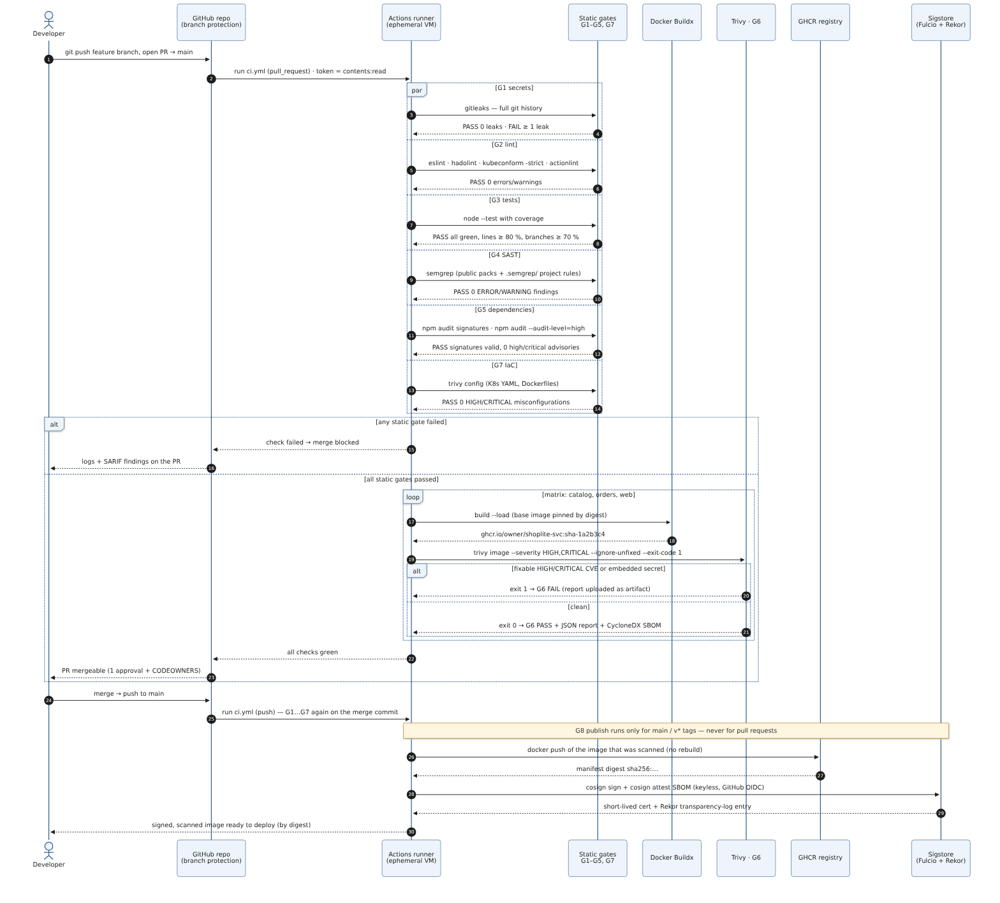
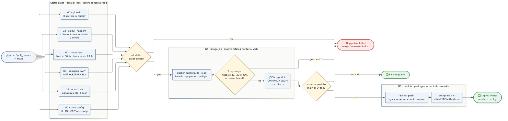
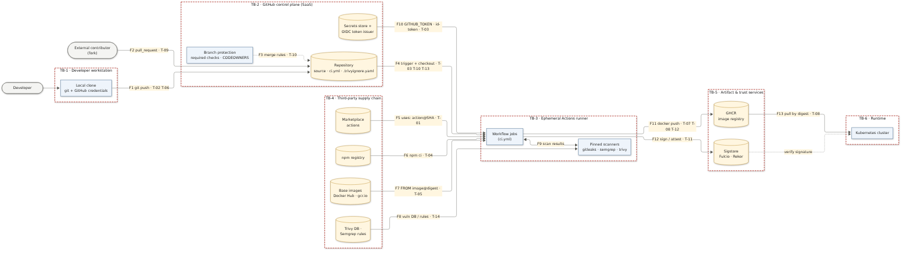

# Week 6 (Lab 2): CI/CD Architecture & DevSecOps Threat Modeling

**System under delivery:** ShopLite, a microservice shop built for these labs (`services/catalog`, `services/orders` in Node.js 24, `services/web` on nginx). Week 7 deploys the same images.

| Deliverable (from the assignment) | Where it is |
|---|---|
| Pipeline Sequence Diagram (UML) with pass/fail criteria per gate | [§2.1](#21-uml-sequence-diagram) · [`diagrams/ci-pipeline-sequence.mmd`](diagrams/ci-pipeline-sequence.mmd) |
| CI/CD pipeline flowchart | [§2.2](#22-pipeline-flowchart) · [`diagrams/ci-pipeline-flow.mmd`](diagrams/ci-pipeline-flow.mmd) |
| Pipeline Threat Model diagram (STRIDE) | [§3.1](#31-data-flow-diagram-with-trust-boundaries) · [`diagrams/threat-model-dfd.mmd`](diagrams/threat-model-dfd.mmd) |
| STRIDE matrix with mitigations | [§3.2](#32-stride-matrix) |
| Functional CI workflow enforcing the gates | [`.github/workflows/ci.yml`](../../.github/workflows/ci.yml) · [§4](#4-implementation-githubworkflowsciyml) |
| Trivy execution report with vulnerability thresholds | [§5](#5-trivy-execution-report) · [`evidence/trivy/`](evidence/trivy/) |

---

## 1. Design goals

1. **Every change goes through the same gates.** A pull request cannot be merged and an image cannot be published unless every gate passed.
2. **Fail fast, fail cheap.** Static checks run in parallel and take seconds. The expensive image build only starts when they are all green.
3. **The pipeline is part of the attack surface.** Third-party actions, registries, the runner token and the workflow file are all treated as threats (§3), not only the application code.
4. **What you scan is what you ship.** The image that passes Trivy is the one that gets pushed and signed, with no rebuild in between.

## 2. Pipeline architecture

### 2.1 UML sequence diagram



### 2.2 Pipeline flowchart



### 2.3 Quality gates and pass/fail criteria

| Gate | Job in `ci.yml` | Tool (pinned) | **PASS** when | **FAIL** when (job exits ≠ 0) |
|---|---|---|---|---|
| **G1** Secrets | `secret-scan` | gitleaks v8.30.1 | 0 findings in the **full git history** | ≥ 1 secret-like string (output is redacted) |
| **G2** Lint (code) | `lint` ×2 | ESLint 10 | 0 errors (`eqeqeq`, `no-eval`, `no-implied-eval`, …) | any ESLint error |
| **G2** Lint (infra) | `lint-infra` | hadolint v2.15.1 · kubeconform v0.8.0 · actionlint 1.7.12 | Dockerfiles: no warning or error. Every rendered K8s object passes `-strict` validation against the 1.37 schema. Workflow passes actionlint and shellcheck | any warning, invalid object or workflow error |
| **G3** Tests | `test` ×2 | `node --test` | all tests pass **and** line coverage ≥ 80 %, branch coverage ≥ 70 % | a failing test or coverage below threshold |
| **G4** SAST | `sast` | Semgrep 1.180.0 with `p/javascript p/nodejs p/secrets p/dockerfile p/kubernetes p/github-actions` + project rules [`.semgrep/`](../../.semgrep/shoplite.yml) | 0 findings at ERROR or WARNING | any blocking finding (`--error`) |
| **G5** Dependencies (SCA) | `deps-audit` ×2 | `npm audit signatures`, `npm audit` | registry signatures valid, 0 HIGH/CRITICAL advisories in production deps | invalid signature or a HIGH/CRITICAL advisory |
| **G6** Image scan | `image` ×3 | Trivy v0.75.0 | 0 **fixable** HIGH/CRITICAL CVEs and 0 secrets in image layers | any fixable HIGH/CRITICAL CVE or any embedded secret |
| **G7** IaC scan | `iac-scan` | Trivy v0.75.0 `config` | 0 HIGH/CRITICAL misconfigurations in K8s YAML and Dockerfiles (excluding scoped, justified entries in [`.trivyignore.yaml`](../../.trivyignore.yaml)) | any HIGH/CRITICAL misconfiguration |
| **G8** Publish | `image` (conditional steps) | docker push, cosign via `sigstore/cosign-installer` v4.1.2 (keyless) | only on `push` to `main` or a `v*.*.*` tag, after G1–G7 passed | never runs for pull requests |

**Why "fixable" HIGH/CRITICAL as the G6 threshold:** a CVE with no fixed version cannot be fixed by the developer, so blocking on it would only teach people to bypass the gate. Unfixed CVEs still appear in the full JSON report (§5) and get re-checked on every run. When a fix ships upstream, the gate starts failing automatically.

### 2.4 Architecture decisions

| Decision | Rationale |
|---|---|
| **Actions pinned to full commit SHA**, container tools pinned to **tag + digest** | Tags can be moved. In March 2026, 76 of 77 `aquasecurity/trivy-action` tags were force-pushed to credential-stealing code (CVE-2026-33634), and `tj-actions/changed-files` was compromised the same way in March 2025 (CVE-2025-30066). A SHA or digest cannot be re-pointed. |
| **Trivy v0.75.0, not v0.76.0** | v0.76.0 was released the day before this lab. The pipeline follows a 7-day cooldown for tools and dependencies, also enforced by Dependabot's `cooldown` setting. Most hijacked releases are detected within days. |
| `permissions: {}` at workflow level, per-job grants | A compromised lint step only has `contents: read`. `packages: write` and `id-token: write` exist only in the publish-capable job. |
| `pull_request`, never `pull_request_target` | Fork PRs run with a read-only token and no secrets, which prevents the "pwn request" class of attack. |
| `persist-credentials: false` on every checkout | The token is not left in `.git/config`, where it could leak through artifacts or later steps. |
| Build once, scan, push the same image | Prevents scan/deploy drift (TOCTOU) and saves a rebuild. |
| `npm ci --ignore-scripts` | npm lifecycle scripts are the main payload channel of npm worms such as Shai-Hulud (Sept 2025). |
| Distroless runtime for the Node services | No shell and no package manager. 30 SBOM components instead of hundreds, and 0 HIGH/CRITICAL CVEs (§5). |
| Keyless cosign signing + CycloneDX SBOM attestation | Binds the image digest to the workflow identity (OIDC) and records it in the Rekor transparency log. This provides non-repudiation (T-11). |

## 3. STRIDE threat model of the pipeline

### 3.1 Data-flow diagram with trust boundaries



| Trust boundary | What crosses it | Why it matters |
|---|---|---|
| TB-1 Developer workstation → GitHub | commits (F1) | workstation credentials can be stolen and code can be pushed under a trusted identity |
| External contributor → GitHub | fork pull requests (F2) | untrusted code executes inside our CI |
| GitHub → runner | workflow definition, source, token (F4, F10) | the runner holds credentials while it executes code from the repo |
| Third-party supply chain → runner | actions, npm packages, base images, vuln DB (F5–F8) | code we did not write runs with our token |
| Runner → registry / Sigstore | images, signatures (F11, F12) | whatever is published here gets deployed |
| Registry → runtime | image pulls (F13) | the cluster trusts what it pulls |

### 3.2 STRIDE matrix

Rating: **L**ikelihood × **I**mpact, each H/M/L. Risk = the higher of the two, raised to **Critical** when both are High.

| ID | STRIDE | Component / flow | Threat & attack scenario | L | I | Risk | Mitigations implemented (where) | Residual risk |
|---|---|---|---|---|---|---|---|---|
| T-01 | **T**ampering | F5 third-party actions | A maintainer account or tag is hijacked. `uses: x@v1` now runs malware that dumps runner memory and secrets (tj-actions 2025, trivy-action 2026). | H | H | **Critical** | All actions pinned to a 40-char SHA. Dependabot (`github-actions`, 7-day cooldown) updates the pins. Per-job least-privilege token. No long-lived secrets used in CI (`ci.yml`, `dependabot.yml`). | A malicious commit pinned by Dependabot after the cooldown. Review the Dependabot PR diff. |
| T-02 | **I**nformation disclosure | F1 source / history | A developer commits a token or password, which stays in git history forever. | H | H | **Critical** | G1 gitleaks scans the **full** history and blocks the PR. Secret values live in git-ignored `db.env` and reach the cluster via kustomize `secretGenerator` (`.gitignore`, Week 7). | Secrets formats unknown to gitleaks. Enable GitHub push protection. |
| T-03 | **I**nformation disclosure | F4/F10 runner token | `GITHUB_TOKEN` or OIDC token is exfiltrated by a malicious step or leaked via `.git/config` in an uploaded artifact (ArtiPACKED class). | M | H | **High** | `permissions: {}` by default. `packages:write` and `id-token:write` only in the `image` job. `persist-credentials: false`. Only reports are uploaded as artifacts. | A compromised step inside the `image` job on `main` still has push rights for that run. |
| T-04 | **T**ampering | F6 npm registry | Dependency poisoning: typosquat, hijacked maintainer, malicious `postinstall` (event-stream 2018, Shai-Hulud worm 2025). | H | H | **Critical** | Lockfile with integrity hashes (`npm ci`). `--ignore-scripts`. G5 `npm audit signatures` + `--audit-level=high`. Dependabot cooldown. Only 1 runtime dependency (`pg`). | Zero-day malicious package not yet in advisories. Mitigated by cooldown and the small dependency tree. |
| T-05 | **T**ampering | F7 base images | Outdated base with known CVEs, or a re-tagged malicious image. | H | M | **High** | Bases pinned by **digest**. G6 Trivy gate. Minimal bases (distroless, nginx-unprivileged). Dependabot `docker` updates. *Demonstrated:* G6 blocked `nginx-unprivileged:1.29-alpine` with 43 fixable HIGH CVEs (§5.2). | Unfixed CVEs in the base. Tracked in the full report. |
| T-06 | **S**poofing | F1 developer identity | A stolen PAT or SSH key pushes malicious code as a trusted developer. | M | H | **High** | `CODEOWNERS` on `.github/`, `k8s/`, `.trivyignore.yaml`. Branch protection on `main` (PR required, 1 approving review, all checks required) and org-level 2FA are repository settings (§7). | Collusion or a compromised reviewer. Add signed commits (`required_signatures`). |
| T-07 | **S**poofing | F11 registry | Someone pushes a look-alike or unauthorised image under our name, or a registry credential is reused elsewhere. | M | H | **High** | Push only from CI with the ephemeral `GITHUB_TOKEN` (no stored registry password). Images are signed keylessly, so consumers can verify the signer identity is this repo's workflow. | Cluster-side enforcement (Kyverno / sigstore policy-controller) is a Week 8+ item. |
| T-08 | **T**ampering | F11/F13 artifact integrity | The image is replaced between scan and deploy (TOCTOU), or a mutable tag such as `:main` is overwritten. | M | H | **High** | The scanned image is pushed as-is. Immutable `sha-<commit>` tags. Deploy by digest. The cosign signature is bound to the digest. | Tag immutability on GHCR is a registry setting. Enable it. |
| T-09 | **E**levation of privilege | F2 fork PR | "Pwn request": a fork PR modifies the build to run with a write token and secrets. | M | H | **High** | Trigger is `pull_request` (read-only token, no secrets for forks). No `pull_request_target`. Publish steps guarded by `event == push && ref == main/tag`. | First-time contributor workflows still need manual approval (repo setting). |
| T-10 | **T**ampering | F3/F4 pipeline definition | An insider edits `ci.yml` or adds a broad `.trivyignore` entry to silence a gate. | M | H | **High** | The workflow and ignore file are code-owned and review-gated. Ignore entries must be **path-scoped, justified and expiring** (`.trivyignore.yaml`). actionlint validates the workflow. | Reviewer fatigue. Keep the ignore list short and auditable. |
| T-11 | **R**epudiation | F12 provenance | Nobody can prove which commit and workflow produced a running image. | M | M | **Medium** | Keyless cosign signature + CycloneDX SBOM attestation in the Rekor public transparency log. OCI labels. `sha-<commit>` tag. Actions run logs. | Logs expire (90 days). Rekor entries do not. |
| T-12 | **I**nformation disclosure | F11 image layers | A `.env` or key file is copied into the image and published. | M | H | **High** | `.dockerignore` excludes `.env*`. Multi-stage build copies only `node_modules` + `src`. G6 runs Trivy `--scanners vuln,secret` on the final image. | Secrets in unusual formats. |
| T-13 | **D**enial of service | F4 runner capacity | A PR with an infinite loop or crypto-miner burns minutes and blocks the queue. | M | L | **Medium** | `timeout-minutes` on every job (5–20). `concurrency` + `cancel-in-progress`. Fork workflows require approval. | Minutes quota is still consumed until the timeout. |
| T-14 | **T**ampering / **D**oS | F8 scanner & feeds | The scanner or its DB is compromised (Trivy v0.69.4, March 2026) or unavailable, so the gate is skipped or lies. | L | H | **High** | Scanner versions pinned (action SHA + `version:` + image digest). Cooldown before upgrades. Trivy fails closed if the DB cannot be downloaded. | Trust in Aqua's DB pipeline. A second scanner (e.g. Grype) could be added. |

STRIDE coverage: S (T-06, T-07) · T (T-01, T-04, T-05, T-08, T-10, T-14) · R (T-11) · I (T-02, T-03, T-12) · D (T-13, T-14) · E (T-09).

### 3.3 Mitigation map: threat → control → gate

| Control | Threats | Implemented in |
|---|---|---|
| Linting (ESLint, hadolint, kubeconform, actionlint) | T-05, T-10 | G2 |
| SAST (Semgrep public packs + project rules) | injection classes in our own code, T-10 | G4 |
| CVE scanning (npm audit, Trivy image) | T-04, T-05 | G5, G6 |
| Secret masking & detection (gitleaks `--redact`, Trivy secret scanner, GitHub log masking) | T-02, T-12 | G1, G6 |
| IaC misconfiguration scanning | insecure K8s/Docker config | G7 |
| SHA/digest pinning + Dependabot cooldown | T-01, T-04, T-05, T-14 | `ci.yml`, Dockerfiles, `dependabot.yml` |
| Least-privilege token, no `pull_request_target` | T-03, T-09 | `ci.yml` |
| Branch protection + CODEOWNERS | T-06, T-10 | `.github/CODEOWNERS` + repo settings |
| Keyless signing + SBOM attestation | T-07, T-08, T-11 | G8 |

## 4. Implementation: [`.github/workflows/ci.yml`](../../.github/workflows/ci.yml)

Supporting files:

| File | Purpose |
|---|---|
| [`.semgrep/shoplite.yml`](../../.semgrep/shoplite.yml) | 3 project rules: `eval`/`Function`, `child_process` with a non-literal command, SQL built by string concatenation. Added after the public packs produced a false negative (§6.2). |
| [`.trivyignore.yaml`](../../.trivyignore.yaml) | The only risk acceptance: KSV-0109 false positive on `postgres-init` (the word `PASSWORD` is an SQL keyword, not a value). Path-scoped, justified, expires 2027-03-31. |
| [`.github/dependabot.yml`](../../.github/dependabot.yml) | Weekly updates for actions, npm and Docker with a 7-day `cooldown`. |
| [`.github/CODEOWNERS`](../../.github/CODEOWNERS) | Second reviewer for the pipeline, the security policy and cluster config. |
| [`scripts/ci-local.sh`](../../scripts/ci-local.sh) | Runs the same gates locally with the **same pinned images** (read out of `ci.yml`, so they cannot drift). |
| [`scripts/negative-tests.sh`](../../scripts/negative-tests.sh) | Plants a fake token and injectable code to prove that G1 and G4 actually fail. |

Key excerpt (G6 gate):

```yaml
- name: G6 · Trivy image gate (fail on fixable HIGH/CRITICAL, any embedded secret)
  uses: aquasecurity/trivy-action@ed142fd0673e97e23eac54620cfb913e5ce36c25 # v0.36.0
  with:
    version: ${{ env.TRIVY_VERSION }}          # v0.75.0
    image-ref: ${{ fromJSON(steps.meta.outputs.json).tags[0] }}
    scanners: vuln,secret
    severity: ${{ env.TRIVY_GATE_SEVERITY }}   # HIGH,CRITICAL
    ignore-unfixed: true
    exit-code: '1'
```

## 5. Trivy execution report

Executed on 2026-10-15 with Trivy v0.75.0 (`aquasec/trivy:0.75.0@sha256:af6acf9a…`) against images built from this repository. The raw reports are in [`evidence/trivy/`](evidence/trivy/): `*-gate.txt` holds the gate output, `*-full.json` and `*-full.txt` hold all severities, and `*-sbom.cdx.json` holds the CycloneDX SBOMs.

### 5.1 Final run: gate passed

| Image | Base image (pinned by digest) | OS | **Gate: fixable HIGH/CRITICAL** | All findings (informational) | SBOM components | Result |
|---|---|---|---|---|---|---|
| `shoplite/catalog:1.0.1` | `gcr.io/distroless/nodejs24-debian13:nonroot` | Debian 13.7 | **0** | 23 MEDIUM, 8 LOW (none with a fix) | 30 | ✅ PASS |
| `shoplite/orders:1.0.1` | `gcr.io/distroless/nodejs24-debian13:nonroot` | Debian 13.7 | **0** | 23 MEDIUM, 8 LOW (none with a fix) | 30 | ✅ PASS |
| `shoplite/web:1.0.1` | `nginxinc/nginx-unprivileged:1.30.6-alpine3.24` | Alpine 3.24.2 | **0** | 1 MEDIUM (fix available, below threshold) | 71 | ✅ PASS |
| npm deps (`pg` tree) | – | – | **0** | 0 | – | ✅ PASS |
| IaC: 9 K8s manifests + 3 Dockerfiles (12 files) | – | – | **0** HIGH/CRITICAL misconfig (1 accepted false positive) | – | – | ✅ PASS |

### 5.2 Blocked run: the gate doing its job

The first version of `services/web` used `nginxinc/nginx-unprivileged:1.29-alpine`. G6 **failed the pipeline**. Evidence: [`evidence/trivy/blocked-run/`](evidence/trivy/blocked-run/).

| Image | OS | HIGH | MEDIUM | LOW | Fixable HIGH | Gate |
|---|---|---|---|---|---|---|
| `shoplite/web:1.0.0` on nginx **1.29**-alpine | Alpine 3.23.4 | **43** | 81 | 50 | **43** | ❌ exit 1 |

The 43 HIGH findings came from 10 packages: `curl`/`libcurl` 8.17.0 (20), `libuuid` (6), `libexpat` (6), `pcre2` (4), `libssl3`/`libcrypto3` 3.5.6 (4), `c-ares`, `libxml2`, `tiff`.

**Root cause:** nginx 1.29 is a closed mainline branch, so its image tag no longer receives Alpine package rebuilds.
**Remediation:** move to the maintained stable branch `1.30.6-alpine3.24` (pinned by digest) and re-scan. The result was 0 HIGH/CRITICAL and the gate passed. Dependabot (`docker` ecosystem) now proposes such bumps automatically.

## 6. Verification

### 6.1 Pipeline runs

The workflow is committed to this repository and was triggered by the push of commit `0091d67` ([run 38738427951](https://github.com/timurdll/devops-labs/actions/runs/38738427951)). **None of that run's jobs started.** GitHub reported *"The job was not started because your account is locked due to a billing issue"*. This is an account-level restriction on GitHub Actions, not a pipeline result: no gate executed. Once the lock is cleared, the run can be repeated with `gh run rerun 38738427951`.

The workflow was validated with `actionlint`, and every gate was run locally by [`scripts/ci-local.sh`](../../scripts/ci-local.sh) using the **same pinned tool images**. Full log: [`evidence/ci-local-run.log`](evidence/ci-local-run.log). Word version of this report: [`Week6-Lab2-Report.docx`](Week6-Lab2-Report.docx).

```
━━━ SUMMARY ━━━
PASS  G1 secret scan (gitleaks)
PASS  G2 lint code (eslint)
PASS  G2 lint infra (hadolint/kubeconform/actionlint)     ← 28/28 K8s objects valid
PASS  G3 unit tests + coverage                            ← catalog 6/6, orders 5/5 · lines 100 %, branches 95 %
PASS  G4 SAST (semgrep)                                   ← 136 rules, 0 findings
PASS  G5 dependency audit (npm audit)                     ← 93 packages with verified registry signatures, 0 vulns
PASS  G7 IaC misconfiguration (trivy config)
PASS  G6 build + image scan (trivy image)
```

### 6.2 Negative tests: proving the gates block

[`scripts/negative-tests.sh`](../../scripts/negative-tests.sh) plants bad code in a throw-away repo. Log: [`evidence/negative-tests.log`](evidence/negative-tests.log).

| Test | Planted defect | Expected | Observed |
|---|---|---|---|
| T1 · G1 | random `ghp_…` GitHub token in `src/config.js` | fail | ✅ gitleaks rule `github-pat`, **exit 1** |
| T2 · G4 public packs only | `eval(query param)`, `exec('ls ' + header)`, SQL via template string | fail | ⚠️ **exit 0, 0 findings: false negative** |
| T3 · G4 public packs + `.semgrep/` | same | fail | ✅ 3 blocking findings, **exit 1** |
| G6 (real, §5.2) | outdated nginx base | fail | ✅ 43 HIGH, **exit 1** |

**Lesson from T2:** the public Semgrep JavaScript and Node rules model Express/Koa request sources, so they did not flag the same sinks in a plain `node:http` service. A SAST gate is only as good as its rules. The pipeline now ships project-specific rules for the dangerous sinks this codebase could actually reach, and the negative test keeps them honest.

## 7. Limitations and next steps

- Branch protection, GHCR tag immutability and fork-PR approval are **repository settings**, not code. They are documented here and must be switched on when the repo is pushed.
- Signature verification at deploy time (Kyverno `verifyImages` or sigstore policy-controller) belongs with the GitOps lab (Week 8).
- The local CI runner is macOS/arm64 while GitHub runners are linux/amd64. The tool versions and digests are identical, but CVE counts for multi-arch base images can differ slightly between architectures.

## Sources

- CVE-2026-33634, Trivy / trivy-action supply-chain compromise: <https://cveawg.mitre.org/api/cve/CVE-2026-33634>, <https://www.rapid7.com/db/vulnerabilities/cve-2026-33634/>
- CVE-2025-30066, tj-actions/changed-files compromise (GitHub Advisory Database)
- Kubernetes blog, Ingress-NGINX retirement (March 2026), relevant to Week 7
