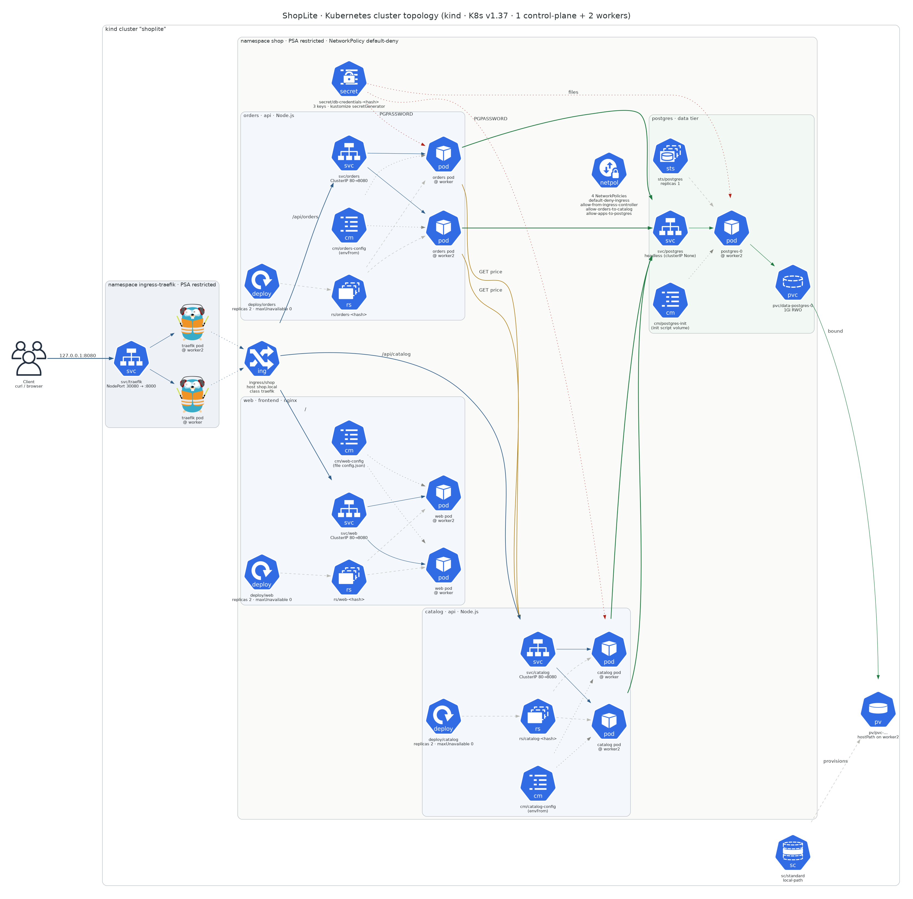
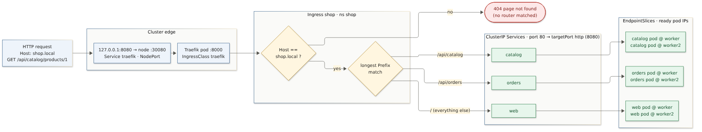
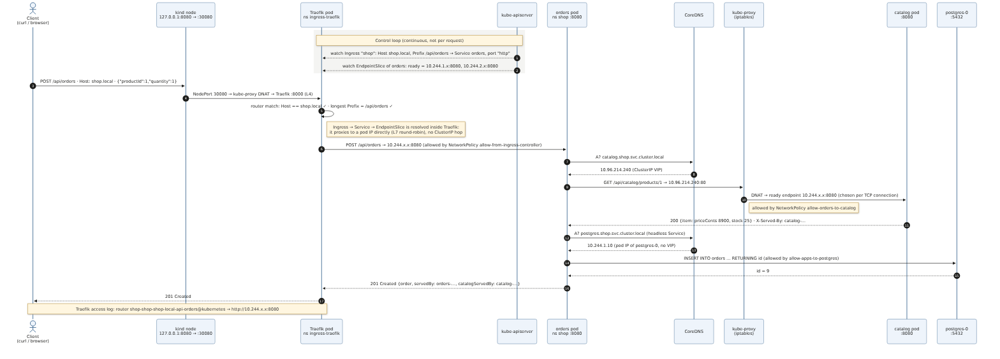
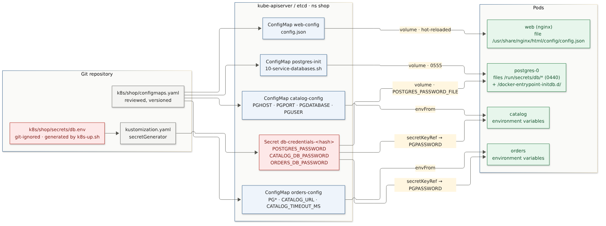

# Week 7 (Lab 3): Kubernetes Cluster Topology & Microservices Architecture

**System:** ShopLite, made of 3 microservices (`web`, `catalog`, `orders`) and PostgreSQL, deployed to a local 3-node **kind** cluster (Kubernetes v1.37). The images are the ones that passed the Week 6 pipeline.

| Deliverable (from the assignment) | Where it is |
|---|---|
| K8s Cluster Architecture / Topology Diagram | [§2](#2-cluster-topology) · [`diagrams/k8s_topology.py`](diagrams/k8s_topology.py) → `k8s-cluster-topology.png` |
| Ingress Request Flow Diagram | [§3](#3-request-traffic-flow) · [`diagrams/ingress-request-flow.mmd`](diagrams/ingress-request-flow.mmd), [`diagrams/ingress-routing-rules.mmd`](diagrams/ingress-routing-rules.mmd) |
| Traffic routes + configuration injection (ConfigMaps vs Secrets) | [§3](#3-request-traffic-flow), [§4](#4-configuration-injection-configmaps-vs-secrets) · [`diagrams/config-injection.mmd`](diagrams/config-injection.mmd) |
| Clean K8s YAML manifest suite | [`k8s/`](../../k8s/) · [§5](#5-manifest-suite) |
| `kubectl` cluster status outputs | [`evidence/`](evidence/) · [§6](#6-deployment-and-runtime-verification) |

---

## 1. Requirements → design

| Requirement | Design decision |
|---|---|
| 2–3 microservices + database | `web` (nginx, static UI), `catalog` (Node.js, product data), `orders` (Node.js, calls `catalog` to price orders), plus `postgres` (StatefulSet) |
| Workload isolation | Separate namespaces for the edge (`ingress-traefik`) and the app (`shop`). Pod Security Admission **restricted** on both. Default-deny **NetworkPolicies** plus 3 allow rules. Database-per-service (two databases and two login roles in one Postgres). No ServiceAccount token mounted in app pods. |
| State management | PostgreSQL as a **StatefulSet** with `volumeClaimTemplates`: stable identity `postgres-0` and a PVC bound to a dynamically provisioned PV (`local-path`). Stateless tiers are Deployments. |
| Request routing | One `Ingress` (Host `shop.local` + path prefixes) → ClusterIP Services → pods. East-west via Service DNS. The DB uses a **headless** Service. |
| Configuration | Non-sensitive config in **ConfigMaps** (in git). Credentials in a **Secret** generated from a git-ignored file. Both env and volume injection patterns are used (§4). |
| Availability | 2 replicas per stateless service with a hard topology spread (one per worker), readiness/liveness probes, `maxUnavailable: 0`, and `preStop` drain. |

**Ingress controller choice:** the Kubernetes project **retired ingress-nginx in March 2026** (repository archived, no security patches). Running it in a DevSecOps course would contradict Week 6. **Traefik v3.7** implements the same `networking.k8s.io/v1` Ingress API and is installed from plain YAML ([`k8s/platform/traefik.yaml`](../../k8s/platform/traefik.yaml)) with least-privilege RBAC: it watches only namespace `shop`, and its ClusterRole is limited to the cluster-scoped `IngressClass` and `Node` kinds.

## 2. Cluster topology



| Namespace | Object | Kind | Replicas / size | Port(s) | Placement (verified) |
|---|---|---|---|---|---|
| `ingress-traefik` | `traefik` | Deployment → ReplicaSet → Pods | 2 | Service **NodePort 30080** → 8000 | worker, worker2 |
|  | `traefik` | IngressClass (cluster-scoped) | – | controller `traefik.io/ingress-controller` | – |
| `shop` | `shop` | Ingress | 3 paths | host `shop.local` | status address 127.0.0.1 |
|  | `web` | Deployment → RS → Pods + ClusterIP Service | 2 | 80 → 8080 | worker, worker2 |
|  | `catalog` | Deployment → RS → Pods + ClusterIP Service | 2 | 80 → 8080 | worker, worker2 |
|  | `orders` | Deployment → RS → Pods + ClusterIP Service | 2 | 80 → 8080 | worker, worker2 |
|  | `postgres` | StatefulSet + **headless** Service | 1 | 5432 | worker2 |
|  | `data-postgres-0` | PVC → PV (`standard` / local-path) | 1 Gi RWO | – | hostPath on worker2 |
|  | `catalog-config`, `orders-config`, `web-config`, `postgres-init` | ConfigMap | 4 | – | – |
|  | `db-credentials-<hash>` | Secret (Opaque, 3 keys) | 1 | – | – |
|  | `default-deny-ingress`, `allow-from-ingress-controller`, `allow-orders-to-catalog`, `allow-apps-to-postgres` | NetworkPolicy | 4 | – | enforced by kindnet |

Node layout: `shoplite-control-plane` (tainted, runs no app pods, receives host traffic on `:30080`), plus `shoplite-worker` and `shoplite-worker2`, which run all workloads.

## 3. Request traffic flow

### 3.1 Host/Path matching → Ingress → ClusterIP Service → Pod endpoint



| Step | Boundary crossed | What happens | Evidence |
|---|---|---|---|
| 1 | host → cluster | `127.0.0.1:8080` is a kind port mapping to the control-plane container's `:30080` | [`kind/cluster.yaml`](../../kind/cluster.yaml) |
| 2 | node → edge pod | **NodePort** Service `traefik`: kube-proxy DNATs to one of the two Traefik pods (L4) | `03-services-endpoints.txt` |
| 3 | edge → routing table | Traefik matches **Host** `shop.local`, then the **longest Prefix**: `/api/catalog`, `/api/orders`, `/`. No match → `404` | `07-traffic-tests.txt` (`Host: other.local` → 404) |
| 4 | routing → Service → endpoints | The Ingress backend names Service + port `http`. Traefik resolves it through the **EndpointSlice** to ready pod IPs and proxies **directly to the pod** (L7 round-robin), so there is no extra ClusterIP hop. The access log shows `http://10.244.x.x:8080` | `07-traffic-tests.txt` (Traefik access log) |
| 5 | namespace boundary | NetworkPolicy `allow-from-ingress-controller` admits only Traefik pods from namespace `ingress-traefik` on :8080 | `08-network-policies.txt` |

### 3.2 End-to-end sequence (north-south + east-west)



**Observed behaviour, cross-checked against the design:**

- **North-south load balancing is per request.** 8 calls to `/api/catalog/products` were split **4 / 4** across the two catalog pods (`X-Served-By` header).
- **East-west load balancing is per connection.** `orders` reaches `catalog` via the ClusterIP `catalog.shop.svc.cluster.local` (CoreDNS → virtual IP → kube-proxy iptables DNAT). Node's `fetch` keeps the TCP connection alive, so each orders pod kept talking to *one* catalog pod: `orders-…zk82g → catalog-…5xz7n` and `orders-…p9vzn → catalog-…cntbb` in all 4 orders. This is expected L4 behaviour. For per-request balancing between services you would need an L7 proxy, which is the Week 10 service-mesh topic.
- **Headless Service:** `postgres.shop.svc.cluster.local` resolves to the **pod IP** `10.244.1.10`, not a VIP. The ClusterIP services resolve to `10.96.x.x` (`03-services-endpoints.txt`).

## 4. Configuration injection: ConfigMaps vs Secrets



| | ConfigMap | Secret |
|---|---|---|
| Contents here | DB host/port/name/user, `CATALOG_URL`, timeouts, UI `config.json`, DB init script | 3 passwords: postgres superuser, `catalog` role, `orders` role |
| Stored in git? | **Yes**, reviewed like code ([`configmaps.yaml`](../../k8s/shop/configmaps.yaml)) | **No.** `secrets/db.env` is git-ignored and generated with 32 random characters by `k8s-up.sh`. Only `db.env.example` is committed. |
| How it is created | plain YAML | kustomize `secretGenerator`, which appends a content hash to the name, so rotating a password rolls every consumer automatically |
| Env injection | `envFrom: configMapRef` (catalog, orders) | `env.valueFrom.secretKeyRef` → `PGPASSWORD` (catalog, orders) |
| File injection | `web-config` mounted as `config.json` (hot-reloaded by kubelet). `postgres-init` mounted as an executable init script | `db-credentials` mounted at `/run/secrets/db` with mode **0440** (group 70), read via `POSTGRES_PASSWORD_FILE`. The postgres container has **0** password env vars |
| Verified in | `05-config-injection.txt` | `05-config-injection.txt` (values masked: `PGPASSWORD=******** (32 chars, from Secret)`) |

**Rule of thumb applied:** prefer **files** for secrets, because env vars leak into crash dumps, `/proc/*/environ` and child processes. Postgres uses the file pattern. The Node services read `PGPASSWORD` from env because that is how the `pg` driver picks it up. A Secret is only base64-encoded in etcd, so production needs etcd encryption at rest and an external secret store (Sealed Secrets, External Secrets Operator or SOPS) instead of a local file.

## 5. Manifest suite

```
kind/cluster.yaml                     3 nodes, host :8080 → NodePort 30080, registry mirror hook
k8s/kustomization.yaml                kubectl apply -k k8s/  (platform + shop)
k8s/platform/traefik.yaml             Namespace, ServiceAccount, ClusterRole(+Binding), Role(+Binding) in shop,
                                      IngressClass, Deployment (×2), Service NodePort
k8s/shop/kustomization.yaml           namespace, secretGenerator, common labels
k8s/shop/namespace.yaml               Namespace shop (PSA restricted)
k8s/shop/configmaps.yaml              4 ConfigMaps
k8s/shop/postgres.yaml                headless Service + StatefulSet + volumeClaimTemplate
k8s/shop/catalog.yaml                 Deployment + ClusterIP Service
k8s/shop/orders.yaml                  Deployment + ClusterIP Service
k8s/shop/web.yaml                     Deployment + ClusterIP Service
k8s/shop/ingress.yaml                 Ingress shop.local → /api/catalog, /api/orders, /
k8s/shop/networkpolicies.yaml         default-deny + 3 allow rules
k8s/shop/secrets/db.env.example       template for the git-ignored Secret source
```

Every pod (app and platform) carries the same hardening, which Week 6 gates G2 (kubeconform -strict) and G7 (trivy config) enforce:
`runAsNonRoot` · fixed non-root UID · `allowPrivilegeEscalation: false` · `readOnlyRootFilesystem: true` (writable `emptyDir` only where needed) · `capabilities.drop: [ALL]` · `seccompProfile: RuntimeDefault` · CPU/memory requests and limits · `automountServiceAccountToken: false` (except Traefik, which needs its token to watch the API) · `enableServiceLinks: false` · images pinned by tag (app) or digest (third-party).

## 6. Deployment and runtime verification

```bash
./scripts/k8s-up.sh            # kind cluster, registry mirror, random secrets, build + kind load, kubectl apply -k k8s/
./scripts/k8s-verify.sh        # captures evidence/01…09 and checks design vs runtime
./scripts/k8s-rollout-test.sh  # rolling restart of every stateless tier under load
```

Evidence files (raw `kubectl` / `curl` output):

| File | Content |
|---|---|
| [`01-cluster.txt`](evidence/01-cluster.txt) | versions, `cluster-info`, nodes, namespaces + PSA labels |
| [`02-workloads.txt`](evidence/02-workloads.txt) | Deployments, ReplicaSets, StatefulSet, pods with node, UID, image |
| [`03-services-endpoints.txt`](evidence/03-services-endpoints.txt) | Services, EndpointSlices, in-cluster DNS lookups |
| [`04-ingress.txt`](evidence/04-ingress.txt) | IngressClass, Ingress, `describe ingress` |
| [`05-config-injection.txt`](evidence/05-config-injection.txt) | ConfigMaps / Secret, env inside pods (masked), mounted files |
| [`06-storage-state.txt`](evidence/06-storage-state.txt) | StorageClass, PVC, PV, databases and roles inside Postgres |
| [`07-traffic-tests.txt`](evidence/07-traffic-tests.txt) | requests through the Ingress, load balancing, east-west calls, Traefik access log |
| [`08-network-policies.txt`](evidence/08-network-policies.txt) | reachability matrix |
| [`09-topology-verification.txt`](evidence/09-topology-verification.txt) | designed vs actual, 30 checks |
| [`10a-…before-fix.txt`](evidence/10a-rolling-update-before-fix.txt) / [`10b-…after-fix.txt`](evidence/10b-rolling-update-after-fix.txt) | rolling update under load |

### 6.1 Designed topology vs runtime state: **30 / 30 checks passed**

```
CHECK                                          EXPECTED                     ACTUAL                       OK
nodes Ready                                    3                            3                            ✓
deploy/catalog ready replicas                  2/2                          2/2                          ✓
deploy/catalog pods on distinct nodes          2                            2                            ✓
svc/catalog ready endpoints                    2                            2                            ✓
…  (same for orders and web)
statefulset/postgres ready                     1/1                          1/1                          ✓
svc/postgres headless                          None                         None                         ✓
pvc/data-postgres-0                            Bound:1Gi                    Bound:1Gi                    ✓
deploy/traefik ready                           2/2                          2/2                          ✓
svc/traefik NodePort                           NodePort:30080               NodePort:30080               ✓
ingress/shop paths                             /api/catalog,/api/orders,/   /api/catalog,/api/orders,/   ✓
ingress/shop status address                    127.0.0.1                    127.0.0.1                    ✓
networkpolicies                                4                            4                            ✓
namespace shop PSA enforce                     restricted                   restricted                   ✓
HTTP GET / · /api/catalog/products · /api/orders  200                       200                          ✓
RESULT: 30 passed, 0 failed
```

### 6.2 Workload isolation: NetworkPolicy reachability matrix

| From → To | Intended | Observed |
|---|---|---|
| orders → catalog :80 | allow | CONNECTED |
| catalog → postgres :5432 | allow | CONNECTED |
| web → catalog :80 | deny | BLOCKED (timeout) |
| web → postgres :5432 | deny | BLOCKED (timeout) |
| catalog → orders :80 | deny | BLOCKED (timeout) |
| pod in `default` ns → catalog.shop :80 | deny | BLOCKED (timeout) |
| *control:* pod in `default` ns → Traefik → web | allow | CONNECTED (so the probe works and the block is real) |

### 6.3 Issues found during verification and how they were fixed

Comparing runtime behaviour against the design surfaced six real defects. Each was fixed in the manifests or code, not by hand in the cluster:

| # | Symptom (evidence) | Root cause | Fix |
|---|---|---|---|
| 1 | First deploy: `GET /api/catalog/products` → 500 `relation "products" does not exist` | `/readyz` only pinged the DB, so pods became Ready **before** their schema migration finished | Readiness = migration done **and** DB reachable (`repo.js`) |
| 2 | `duplicate key … pg_type_typname_nsp_index` in Postgres logs | 2 replicas ran `CREATE TABLE IF NOT EXISTS` concurrently, a known Postgres race | Migration runs inside a transaction holding `pg_advisory_xact_lock` |
| 3 | Pods saw `CATALOG_SERVICE_HOST`, `CATALOG_PORT=tcp://…` and similar env vars | Legacy Docker-link service env vars are on by default and can collide with app config | `enableServiceLinks: false` on every pod |
| 4 | Rolling update under load: **87 of 834 requests failed** (55×502, 31 timeouts, 1×500) → `10a` | Pods stopped listening before Traefik and EndpointSlices dropped them. Single Traefik replica. Postgres restarted (single replica) | `preStop: sleep 5s` (native sleep action, since distroless has no `/bin/sleep`). Traefik ×2 with `requestAcceptGraceTimeout=5s`. Result: **0 of 3 440 failed** → `10b` |
| 5 | Verification: 2 replicas of `orders` and `web` on the **same** node | `ScheduleAnyway` is only a preference, and surge pods from the old ReplicaSet skewed the count | `whenUnsatisfiable: DoNotSchedule` + `matchLabelKeys: [pod-template-hash]` + `nodeTaintsPolicy: Honor` → 30/30 |
| 6 | Traefik replica stuck in `ImagePullBackOff` | Docker Hub `429 Too Many Requests` (anonymous pull limit) | containerd `hosts.toml` sends `docker.io` pulls through `mirror.gcr.io`. This is safe because every third-party image is pinned by digest (`kind/cluster.yaml`, `k8s-up.sh`) |

**Known limitation:** PostgreSQL is a single replica. Any change to its pod template restarts it, which means a few seconds of API errors (part of the 87 errors in #4). Zero-downtime database changes need an HA Postgres operator (e.g. CloudNativePG) and the expand/contract migration strategy from Week 13.

## 7. Notes

- The local `kubectl` client is v1.34 and the server is v1.37. `kubectl version` warns about the skew (see `01-cluster.txt`). All commands used are stable APIs and behaved as expected.
- The host is Docker Desktop on Apple Silicon (arm64). Every image used is multi-arch.
