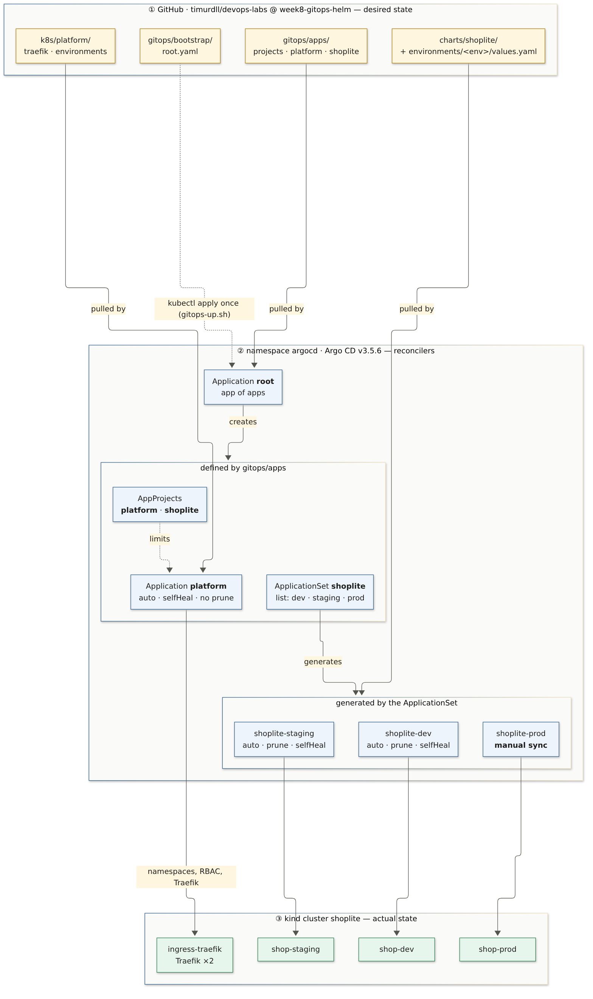
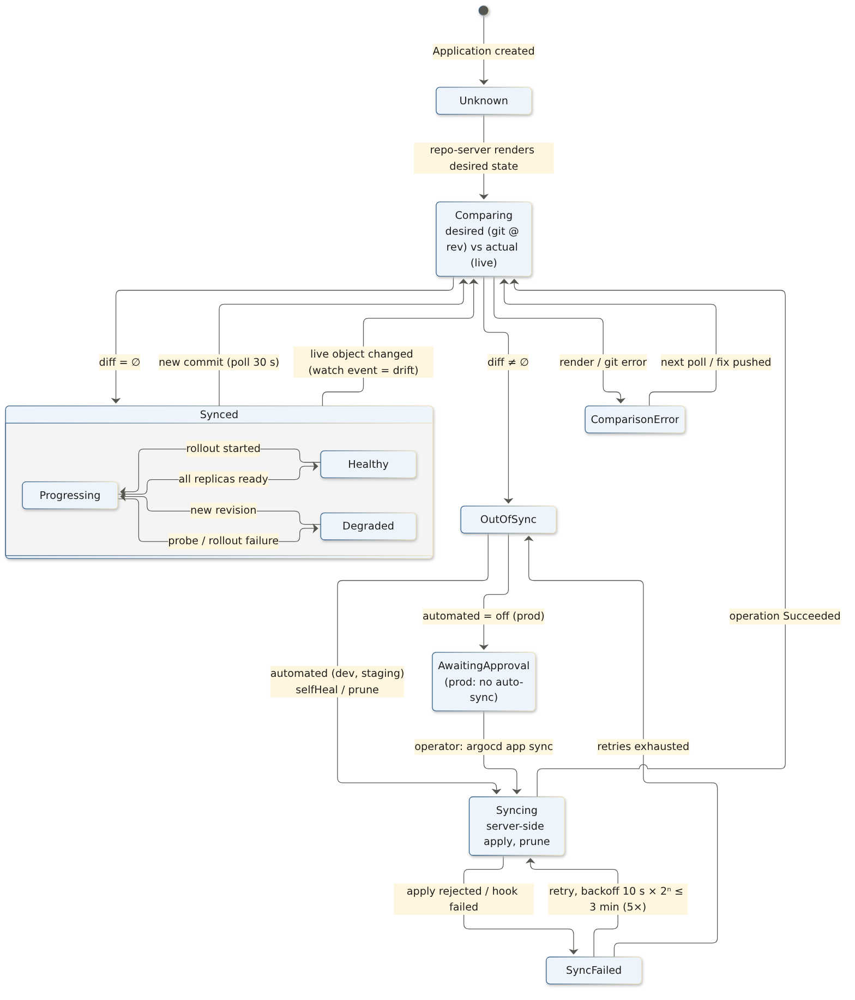
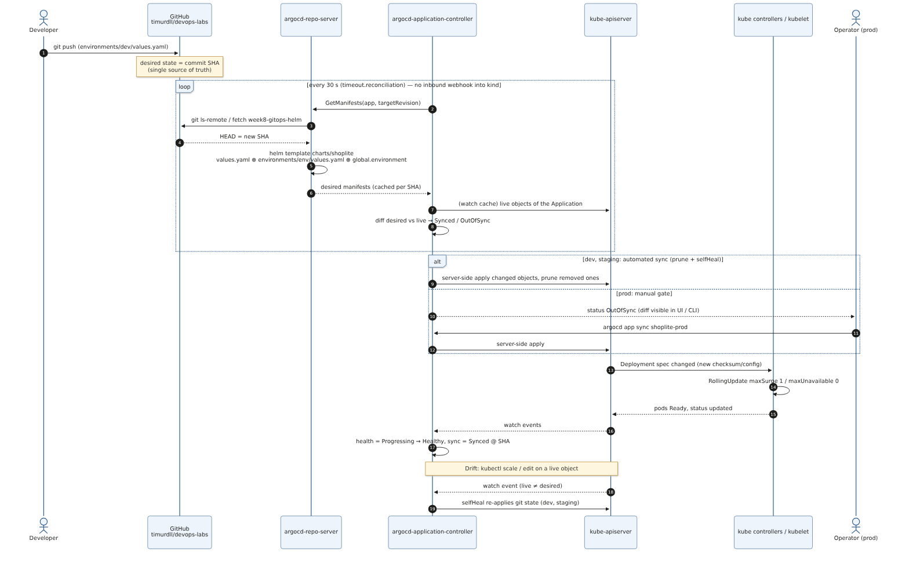
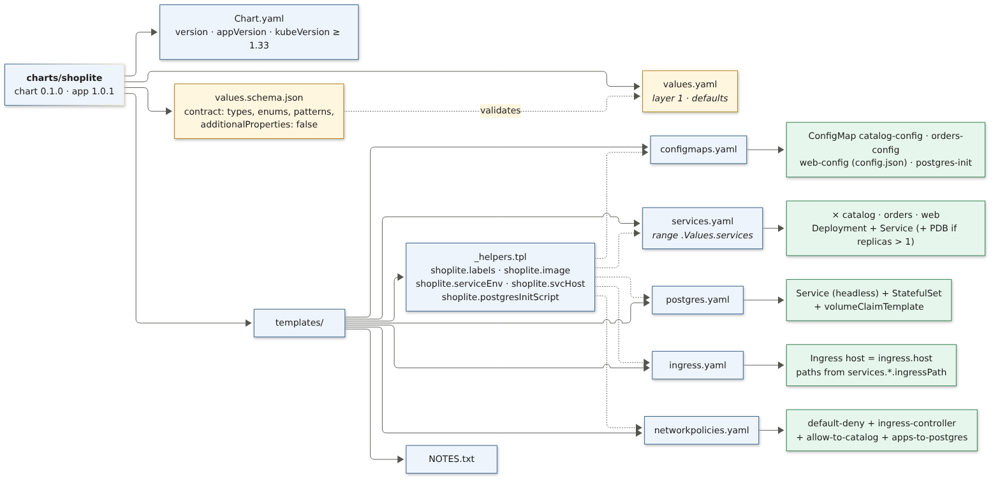
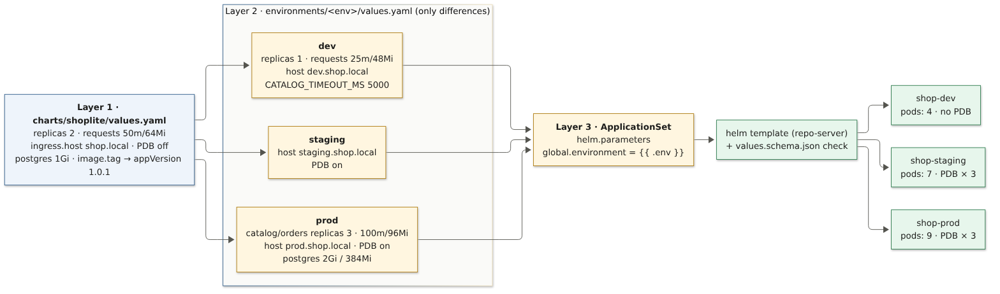
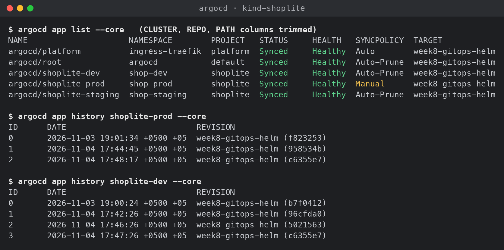

# Week 8 (Lab 4): GitOps Delivery Architecture & Helm Package Design

Word version of this report: [`Week8-Lab4-Report.docx`](Week8-Lab4-Report.docx). Architecture decisions: [`adr.md`](adr.md).

**System:** ShopLite from Week 7 (`web`, `catalog`, `orders` + PostgreSQL) on the same 3-node **kind** cluster. The Week 7 manifests are now one **Helm chart** deployed to **three environments** by **Argo CD v3.5.6**. After the one-time bootstrap, the only way to change the cluster is a commit to `timurdll/devops-labs`.

| Deliverable (from the assignment) | Where it is |
|---|---|
| GitOps State Reconciliation Diagram (FSM) | [§2.1](#21-state-machine-of-one-application) · [`diagrams/gitops-state-machine.mmd`](diagrams/gitops-state-machine.mmd) |
| GitOps Reconciliation **Sequence** Diagram (Git ↔ Argo CD ↔ API server) | [§2.2](#22-reconciliation-loop) · [`diagrams/gitops-reconciliation-sequence.mmd`](diagrams/gitops-reconciliation-sequence.mmd) |
| Helm Chart hierarchy scheme | [§3.1](#31-chart-hierarchy) · [`diagrams/helm-chart-structure.mmd`](diagrams/helm-chart-structure.mmd) |
| Multi-environment configuration tree / variable inheritance | [§3.2](#32-environment-configuration-tree-and-inheritance) · [`diagrams/values-inheritance.mmd`](diagrams/values-inheritance.mmd) |
| Parameter schema (`values.yaml`) | [`charts/shoplite/values.yaml`](../../charts/shoplite/values.yaml) + [`values.schema.json`](../../charts/shoplite/values.schema.json) · [§3.3](#33-parameter-schema) |
| Static YAML → reusable Helm chart | [`charts/shoplite/`](../../charts/shoplite/) · [§3](#3-helm-package-design) |
| Argo CD deployed, pointed at the repo, sync on commit | [`gitops/`](../../gitops/) · [§4](#4-gitops-delivery-on-the-cluster) |
| Argo CD sync screenshot / log | [§5](#5-observed-reconciliation-evidence) · [`evidence/`](evidence/) · `evidence/argocd-sync-cli.png` |

---

## 1. Requirements → design

| Requirement | Design decision |
|---|---|
| Environment configuration management | 3 environments = 3 namespaces (`shop-dev`, `shop-staging`, `shop-prod`), each with PSA *restricted*, its own Secret and its own database. One values file per environment holds **only the differences** ([ADR-W8-02](adr.md#adr-w8-02--environments--directory-per-environment-on-one-branch-namespace-per-environment)). |
| Declarative package abstraction | One chart `charts/shoplite` 0.1.1. The services are a map that one template iterates over. The hardening is hard-coded, not configurable. A strict JSON schema is the contract. |
| Git-driven continuous delivery | Argo CD, **app of apps**: `root` → AppProjects + `platform` + ApplicationSet `shoplite` → `shoplite-{dev,staging,prod}` ([ADR-W8-01](adr.md#adr-w8-01--argo-cd-as-the-gitops-controller)). |
| Safe production | `prod` is **not auto-synced**: drift from git shows as `OutOfSync`, and an operator approves the sync with a reviewed diff ([ADR-W8-04](adr.md#adr-w8-04--sync-policy-per-environment)). |
| Least privilege for the controller itself | AppProject `shoplite`: no cluster-scoped kinds, 7 namespaced kinds, 3 destination namespaces. AppProject `platform`: Namespaces, IngressClass and ClusterRole(Binding) only. |
| Secrets | Never in git. The chart references `database.existingSecret` ([ADR-W8-03](adr.md#adr-w8-03--database-credentials-stay-out-of-git-for-now)). |



## 2. GitOps state reconciliation

### 2.1 State machine of one Application

Git holds the **desired state** (a commit SHA). The cluster holds the **actual state**. Argo CD tracks two independent axes: *sync status* (does live equal desired?) and *health* (is it working?). The diagram shows the states and transitions that occurred in this lab (§5).



| From → To | Trigger | Observed in |
|---|---|---|
| Synced → Comparing → OutOfSync | new commit, picked up by the 30 s poll | `03-…`, `05-…` |
| Synced → OutOfSync (drift) | `kubectl scale` on a live Deployment (watch event) | `04-…` |
| OutOfSync → Syncing → Synced | automated sync (dev, staging) | `03-…`, `03b-…` |
| OutOfSync → AwaitingApproval → Syncing | prod: no auto-sync, operator runs `gitops-sync-prod.sh` | `02-…`, `05-…` |
| Synced(Progressing) → Synced(Healthy) | rolling update finished | `03-…` |
| ComparisonError / Unknown | **git unreachable**: no comparison, no self-heal | `09-observation-git-unreachable.txt` |

### 2.2 Reconciliation loop



It is a pull model: nothing outside the cluster needs credentials for it. The repo-server renders `helm template` with the 3 value layers and caches the result per commit SHA. The application controller compares that render with the live objects from its watch cache, then server-side-applies the difference. Drift is detected **immediately**, from watch events. New commits are detected by **polling** every 30 s, because GitHub cannot reach a kind cluster with a webhook ([ADR-W8-05](adr.md#adr-w8-05--change-detection-by-30-s-polling)).

## 3. Helm package design

### 3.1 Chart hierarchy



```
charts/shoplite/
  Chart.yaml               version 0.1.1 · appVersion 1.0.1 · kubeVersion >= 1.33
  values.yaml              layer 1: defaults (the parameter schema, documented inline)
  values.schema.json       contract: types, enums, patterns, additionalProperties: false
  templates/
    _helpers.tpl           labels · image ref (tag precedence) · service env · svc DNS · DB init script
    configmaps.yaml        <svc>-config (envFrom) · web-config (config.json) · postgres-init
    services.yaml          range .Values.services → Deployment + Service (+ PDB)
    postgres.yaml          headless Service + StatefulSet + volumeClaimTemplate
    ingress.yaml           host from ingress.host, paths from services.*.ingressPath (longest first)
    networkpolicies.yaml   default-deny + ingress controller + allowFrom + DB clients
    NOTES.txt
```

**Parameterisation choices**

- **What is a parameter:** replicas, resources, image registry/tag, ingress host, extra env, UI config, storage, PDB on/off, topology spread on/off. **What is not:** the security context, probes' ports, `automountServiceAccountToken`, `enableServiceLinks`. Making those configurable would let one values file switch off the Week 6/7 controls. Trivy (G7) scans the *rendered* chart for each environment to prove they hold.
- **Derived, not duplicated:** `PGHOST`, `CATALOG_URL`, the DB init script and the NetworkPolicy peer lists are computed from `services.*` and `.Release.Namespace`. Adding a database-backed service is one map entry.
- **Config changes roll pods:** the `checksum/config` annotation replaces kustomize's hash-suffixed names from Week 7. `web-config` is a mounted file and is hot-reloaded, so it has no checksum.
- **Selectors unchanged** (`app.kubernetes.io/name` only). Deployment selectors are immutable, so moving from the Week 7 manifests does not require recreating objects.

### 3.2 Environment configuration tree and inheritance

```
charts/shoplite/values.yaml        ← layer 1 (shared defaults)
environments/
  dev/values.yaml                  ← layer 2 (21 lines: replicas 1, small requests, dev host, banner)
  staging/values.yaml              ← layer 2 (prod shape: PDBs, staging host)
  prod/values.yaml                 ← layer 2 (3 replicas for APIs, bigger requests, 2Gi DB)
gitops/apps/shoplite.yaml          ← layer 3 (global.environment = generator element)
```



| Key | Chart default | dev | staging | prod |
|---|---|---|---|---|
| `services.catalog.replicas` | 2 | **1** → **2** (demo) | 2 | **3** |
| `services.orders.replicas` | 2 | **1** | 2 | **3** |
| `services.web.replicas` | 2 | **1** → **2** (demo) | 2 | 2 |
| `services.*.resources.requests` | 50m / 64Mi | **25m / 48Mi** | 50m / 64Mi | **100m / 96Mi** |
| `ingress.host` | shop.local | **dev.shop.local** | **staging.shop.local** | **prod.shop.local** |
| `podDisruptionBudget.enabled` | false | false | **true** | **true** |
| `services.orders.env.CATALOG_TIMEOUT_MS` | 2000 | **5000** | 2000 | 2000 |
| `postgres.storage.size` | 1Gi | 1Gi | 1Gi | **2Gi** |
| `global.environment` | "" (required) | dev | staging | prod (from the ApplicationSet) |

Maps merge deeply and scalars/lists are replaced, so an environment file never repeats a default.

### 3.3 Parameter schema

`values.yaml` is the documented parameter set, and `values.schema.json` makes it a **contract**. `helm lint/template` and Argo CD's repo-server reject an invalid file before anything reaches the API server:

```
--set global.environment=qa          → at '/global/environment': value must be one of 'dev', 'staging', 'prod'
--set image.tag=latest               → at '/image/tag': 'not' failed        (mutable tags forbidden)
--set services.web.replicas=0        → at '/services/web/replicas': minimum: got 0, want 1
--set services.web.replica=3         → at '/services/web': additional properties 'replica' not allowed   (typo caught)
--set services.catalog.env.DB_PASSWORD=x  → invalid propertyName 'DB_PASSWORD'   (secrets never in env/values)
postgres.image without @sha256:      → pattern mismatch                     (third-party images digest-pinned)
```

**CI (Week 6 gates, extended):** G2 runs `helm lint --strict` plus a `kubeconform -strict` render for each environment (57 objects), and validates the Argo CD CRs against the datree CRD catalog. G7 runs `trivy config` on the chart rendered with each environment's values. The default root scan *skipped* the chart, because it cannot render without `global.environment`. That gap was found here and closed.

## 4. GitOps delivery on the cluster

```bash
./scripts/gitops-up.sh          # install Argo CD (pinned), env namespaces + secrets, apply root app
./scripts/gitops-sync-prod.sh   # prod approval gate: shows the diff, then syncs
./scripts/gitops-verify.sh      # evidence 01, 06, 07, 08 (31 design-vs-runtime checks)
./scripts/gitops-demo.sh        # scenarios A/B/C below (pushes demo commits)
./scripts/gitops-watch.sh shoplite-dev 120   # print every state transition of one Application
```

| Object | Kind | Source in git | Sync policy |
|---|---|---|---|
| `root` | Application | `gitops/apps` | auto · prune · self-heal |
| `platform`, `shoplite` | AppProject | `gitops/apps/projects.yaml` | – |
| `platform` | Application (wave -1) | `k8s/platform` (Traefik + env namespaces + RBAC) | auto · self-heal · **no prune** |
| `shoplite` | ApplicationSet (list generator) | `gitops/apps/shoplite.yaml` | – |
| `shoplite-dev` / `-staging` | Application | `charts/shoplite` + `environments/<env>` | auto · prune · self-heal · retry 5× backoff |
| `shoplite-prod` | Application | `charts/shoplite` + `environments/prod` | **manual** |

Traefik now watches the three new namespaces, granted via one ClusterRole `traefik-ingress-namespaced` and a RoleBinding per namespace. The Week 7 `shop` namespace keeps working unchanged.

## 5. Observed reconciliation (evidence)



| # | Scenario | Timeline (from `gitops-watch.sh`) | Result |
|---|---|---|---|
| 0 | **Bootstrap fix via git:** `platform` showed `InvalidSpecError` (empty destination namespace). The fix was pushed as commit `98636da` | push → `Synced/Progressing` **+15 s** → `Healthy` +28 s | `00-bootstrap.txt` |
| 1 | **First prod release** needs approval | prod `OutOfSync/Missing` until `gitops-sync-prod.sh` → 20 objects created | `02-prod-first-sync.txt` |
| A | **Commit to dev** (`catalog` 1→2, new banner), commit `017a7f4` | `OutOfSync` **+5 s** → `Synced/Progressing` +6 s → `Healthy` **+8 s** | `03-scenario-a-commit-to-dev.txt` |
| A2 | **Scale through git after the chart fix** (`web` 1→2), commit `4f8ad1b` | `OutOfSync` +46 s → `Healthy` +48 s. The running pod **survived** (only one pod added) | `03b-scenario-a2-scale-without-restart.txt` |
| B | **Drift:** `kubectl scale deploy/orders --replicas=5` in staging | self-heal in **< 1 s**: 3 pods created and deleted within the same second. The controller log shows a *partial* sync of only `Deployment/orders` | `04-scenario-b-drift-self-heal.txt` |
| C | **Commit to prod** (release banner), commit `4ba6625` | `OutOfSync` +47 s, then **stays** `OutOfSync` (prod still served the old config) → approval → `Synced/Healthy` | `05-scenario-c-prod-manual-gate.txt` |

Commit-to-detection time was 5–47 s, within the designed bound of one 30 s poll plus the repo-server's revision cache.

### 5.1 Design vs runtime: **31 / 31 checks passed** ([`08-design-vs-runtime.txt`](evidence/08-design-vs-runtime.txt))

The oracle is `helm template` of the *current git commit*. For every environment, the script checks:
- the app is `Synced/Healthy` at git HEAD
- ready/desired replicas for each Deployment
- the ingress host
- the PDB count
- the PVC size
- PSA restricted
- HTTP 200 through Traefik

It also checks that the Secret is not tracked by Argo CD. Orders were placed successfully in all three environments (`07-traffic-tests.txt`). An isolation probe carrying the `orders` label could reach `postgres.shop-dev` but was **BLOCKED** to `shop-staging` and `shop-prod`.

### 5.2 Issues found while verifying

| # | Symptom | Root cause | Fix |
|---|---|---|---|
| 1 | `platform` Application `Unknown`, `InvalidSpecError` | Destination namespace `""` is not in AppProject `platform`'s list | `destination.namespace: ingress-traefik`, fixed **through git** (scenario 0) |
| 2 | Trivy G7 reported 0 findings for the chart, because it never scanned it | The chart fails to render without `global.environment`, and Trivy silently skips it | G7 scans once per environment with `--helm-values` |
| 3 | Scenario A: scaling `catalog` 1→2 **restarted** the existing pod | `topologySpreadConstraints` was only rendered for `replicas > 1`, so the pod template changed | Always render it (chart 0.1.1). Scenario A2 proves scaling now adds pods without restarting any |
| 4 | Argo CD `Synced` while prod still served the **old** banner for **47 s** | `config.json` is a mounted ConfigMap, which kubelet refreshes on its sync period (eventual) | Documented. For config that must switch atomically, use `checksum/config` (roll the pods) as for the env-var services |
| 5 | GitHub unreachable for ~30 min during the first demo run | Network outage on the host (SSH :22 and HTTPS :443 refused) | Apps went `Unknown`, **and self-heal stopped**: the injected drift (5 replicas) stayed until GitHub was back, then healed on its own (`09-…`). Lesson: git is a runtime dependency of reconciliation. Production uses an HA git mirror or OCI-hosted charts and alerts on `ComparisonError`. The demo script now aborts if a push fails |
| 6 | Image pull of `quay.io/argoproj/argocd` took > 25 min | Slow uplink, with three parallel pulls of a 211 MB image | No change in git. Documented: pre-load with `kind load docker-image` or use a pull-through cache |

## 6. Notes and limitations

- The Applications track the branch `week8-gitops-helm`. After merging to `main`, switch `targetRevision` in `gitops/bootstrap/root.yaml`, `gitops/apps/platform.yaml` and `gitops/apps/shoplite.yaml` to `main` (one commit, which Argo CD applies to itself).
- No UI screenshot is included because the evidence uses `argocd --core`, which reads the Application CRs through the Kubernetes API without logging in. To view the UI: `kubectl -n argocd port-forward svc/argocd-server 8081:80`, then log in as `admin` with the password from `argocd-initial-admin-secret`.
- Images are still loaded into kind from the local Docker daemon. With the Week 6 registry (`image.registry: ghcr.io/timurdll/devops-labs`), promotion becomes: CI pushes a signed tag → PR bumps `image.tag` in `environments/dev` → staging → prod.
