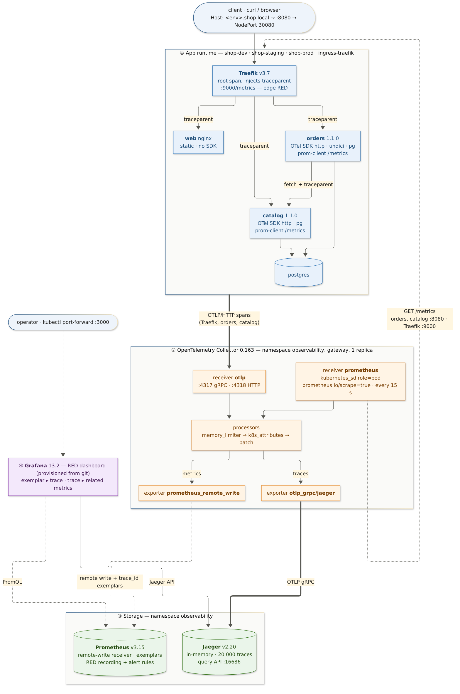
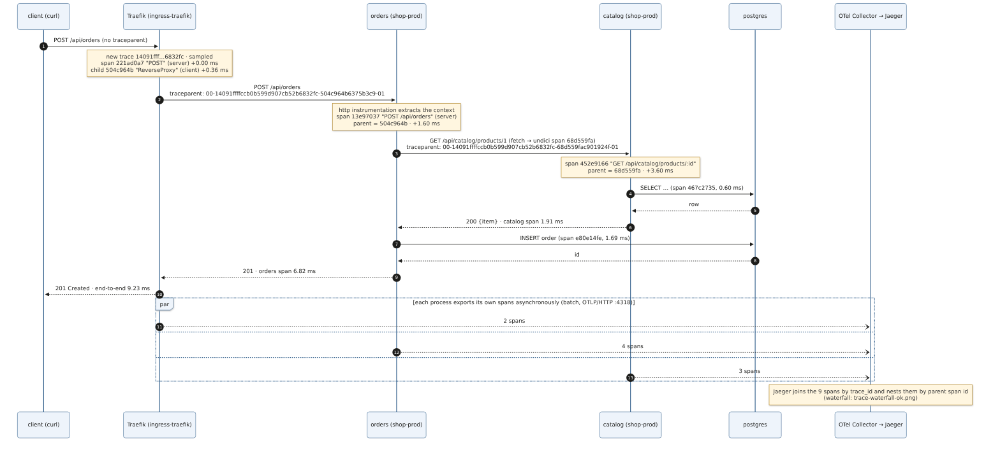
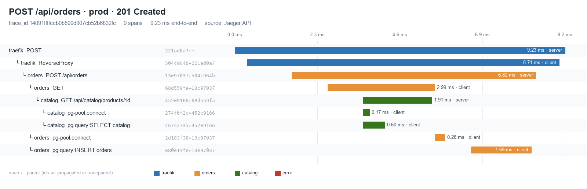
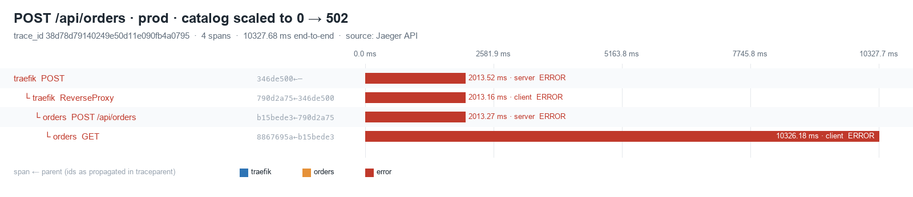
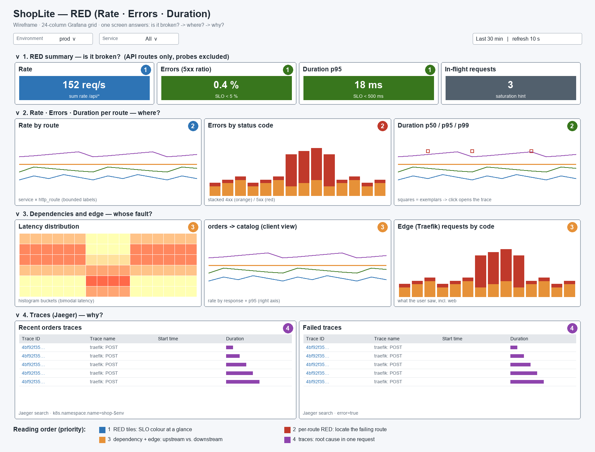
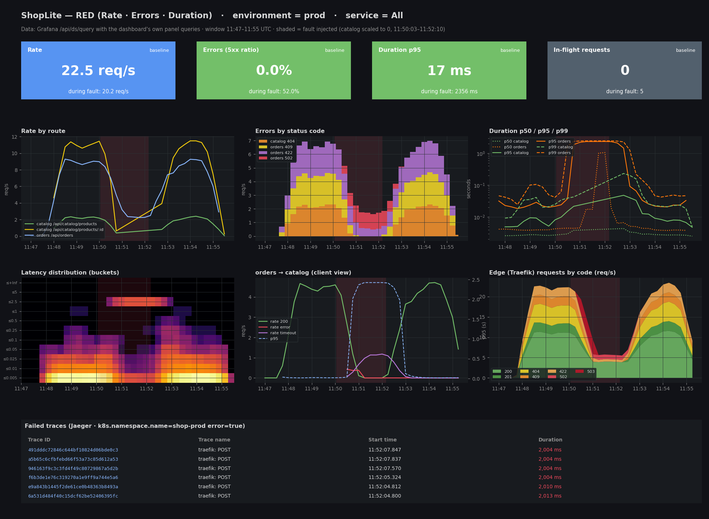

# Week 9 (Lab 5): Distributed Observability & Telemetry Data Flow Design

Word version of this report: [`Week9-Lab5-Report.docx`](Week9-Lab5-Report.docx). Architecture decisions: [`adr.md`](adr.md).

**System:** ShopLite from Weeks 7–8 (Traefik → `web`, `catalog`, `orders` → PostgreSQL) in three GitOps environments on the kind cluster. This week adds:
- **instrumentation** in the services: Prometheus client SDK plus OpenTelemetry tracing;
- **a telemetry pipeline:** OpenTelemetry Collector → Prometheus + Jaeger → Grafana.

Everything is delivered the Week 8 way: a commit, then an Argo CD sync.

| Deliverable (from the assignment) | Where it is |
|---|---|
| Telemetry Data Flow Diagram (App → Collector → Prometheus/Jaeger → Grafana) | [§2](#2-telemetry-architecture) · [`diagrams/telemetry-data-flow.mmd`](diagrams/telemetry-data-flow.mmd) |
| Distributed Trace Sequence diagram (`traceparent` across services) | [§3.3](#33-trace-propagation) · [`diagrams/trace-propagation-sequence.mmd`](diagrams/trace-propagation-sequence.mmd) |
| Trace Waterfall diagram | [§3.3](#33-trace-propagation) · [`diagrams/trace-waterfall-ok.png`](diagrams/trace-waterfall-ok.png), [`trace-waterfall-error.png`](diagrams/trace-waterfall-error.png) (from real traces) |
| Grafana dashboard wireframe (RED prioritised) | [§4](#4-dashboard-design) · [`diagrams/grafana-wireframe.png`](diagrams/grafana-wireframe.png) |
| Instrumented APIs: Prometheus SDK `/metrics` + OTel tracing headers | [`services/*/src/telemetry/`](../../services/catalog/src/telemetry/) · [§3](#3-instrumentation) |
| Telemetry collected in Grafana/Jaeger, evaluated against the design | [§6](#6-experiment-and-evidence) · [§7](#7-evaluation-design-vs-observed) · [`evidence/`](evidence/) |
| Exported JSON configuration files | [`exports/`](exports/): Grafana dashboard + data sources, Collector, Prometheus config + rules, Jaeger config, panel query results, raw traces |

---

## 1. Requirements → design

| Requirement | Design decision |
|---|---|
| End-to-end telemetry, one path for every signal | Apps know **one** endpoint: the Collector. It receives spans (OTLP), scrapes metrics and routes both to their stores ([ADR-W9-02](adr.md#adr-w9-02--one-collector-as-the-telemetry-gateway)). |
| RED metrics via the Prometheus client SDK | `prom-client` histogram `http_server_request_duration_seconds{http_request_method,http_route,http_response_status_code}`. **R** = rate of `_count`, **E** = rate of 5xx `_count`, **D** = `histogram_quantile` over `_bucket`. Names follow the OTel HTTP semantic conventions ([ADR-W9-01](adr.md#adr-w9-01--opentelemetry-for-traces-prometheus-exposition-for-metrics)). |
| Distributed tracing with standard headers | OTel Node SDK. W3C `traceparent` is extracted by the `http` instrumentation and injected by `undici` (`fetch`). Traefik starts the trace ([ADR-W9-06](adr.md#adr-w9-06--sampling-100--head-sampling-decided-at-the-edge)). |
| Metrics ↔ traces correlation | Every latency observation carries the active `trace_id` as an OpenMetrics **exemplar**. Grafana links an exemplar dot to the Jaeger trace. |
| Bounded cardinality | `http_route` is a template (`/api/catalog/products/:id`). Unknown paths become `unmatched`. No user or product ids appear in labels. |
| Probes are not traffic | `/healthz`, `/readyz` and `/metrics` are not traced. Dashboard queries filter `http_route=~"/api/.*"`. |
| Same delivery model as Week 8 | Chart **0.2.0** turns on telemetry per environment. Argo CD Application `observability` deploys `k8s/observability`. prod went through the manual approval gate. |
| Secure by default | Default-deny NetworkPolicies in `observability`. Only the Collector may scrape app pods (`allow-telemetry-scrape`). Grafana has no anonymous access and no Ingress, and its admin Secret is not in git. All images are digest-pinned. |

## 2. Telemetry architecture



| Signal | Produced by | Transport | Stored in | Read by |
|---|---|---|---|---|
| Server RED metrics | `catalog`, `orders` (`prom-client`, OpenMetrics) | **pull**: Collector `prometheus` receiver, `kubernetes_sd` role=pod, every 15 s → **push**: `prometheus_remote_write` | Prometheus v3.15 (TSDB + exemplar storage) | Grafana (PromQL), alert rules |
| Client RED (orders → catalog) | `orders` `http_client_request_duration_seconds` | same | Prometheus | Grafana panel “orders → catalog” |
| Edge RED | Traefik `:9000/metrics` | same | Prometheus | Grafana panel “Edge (Traefik)” |
| Spans | Traefik, `orders`, `catalog` (OTel SDK) | **push**: OTLP/HTTP `:4318` → Collector (`k8s_attributes` adds pod/namespace/deployment) → OTLP gRPC | Jaeger v2.20 (memory) | Jaeger UI, Grafana Jaeger data source |
| Collector health | Collector `:8888` | scraped by the Collector itself | Prometheus | `telemetry-verify.py` (accepted/refused spans) |

Labels added at scrape time: `namespace`, `pod`, `app` and `environment` (from the pod label `shoplite.io/environment`; Traefik gets `environment="edge"`). These make one dashboard work for all three environments through the `$env` variable.

## 3. Instrumentation

### 3.1 Metrics (`services/*/src/telemetry/metrics.js`)

```text
GET /metrics   Content-Type: application/openmetrics-text; version=1.0.0
http_server_request_duration_seconds_bucket{le="2.5",service="orders",http_request_method="POST",
  http_route="/api/orders",http_response_status_code="502"} 53 # {trace_id="491dddc7…",span_id="0c96e20b…"} 2.0017
http_server_active_requests{http_request_method="POST",service="orders"} 0
http_client_request_duration_seconds_count{service="orders",server_address="catalog.shop-prod.svc.cluster.local",
  http_response_status_code="timeout"} 43
```

(Excerpt of [`evidence/07-metrics-endpoint-sample.txt`](evidence/07-metrics-endpoint-sample.txt). The exemplar's trace is the first row of the dashboard's “Failed traces” table.)

- **Buckets:** 5 ms … 5 s, matching the 500 ms SLO and the 2 s / 5 s client timeouts.
- **Process metrics:** the Node.js default metrics (CPU, heap, event-loop lag) are also exported.
- **Tests:** unit tests cover the module (exemplar present or absent, active-request gauge, client histogram). The CI coverage gate now includes `metrics.js` and `catalog-client.js`. Current results: catalog 11 tests, orders 13 tests, 100 % lines.

### 3.2 Tracing (`services/*/src/telemetry/tracing.js`)

`require('./telemetry/tracing')` is the **first line** of `server.js`, so the instrumentations patch `http`, `pg` and `undici` before anything else loads them. The configuration is standard `OTEL_*` variables rendered by the chart:

```text
OTEL_SERVICE_NAME=orders   OTEL_EXPORTER_OTLP_ENDPOINT=http://otel-collector.observability.svc.cluster.local:4318
OTEL_TRACES_SAMPLER=parentbased_traceidratio   OTEL_TRACES_SAMPLER_ARG=1.0   OTEL_PROPAGATORS=tracecontext,baggage
OTEL_RESOURCE_ATTRIBUTES=deployment.environment.name=prod,service.namespace=shoplite,service.version=1.1.0
```

- **Span names:** the handler renames the server span to `METHOD route-template`, sets `http.route`, and records exceptions with `status=ERROR`.
- **Log correlation:** error log lines carry `trace_id=…`.
- **SQL privacy:** SQL parameters are never recorded (`enhancedDatabaseReporting: false`).
- **Failure isolation:** if the Collector is down, spans are dropped; requests never wait for telemetry.

### 3.3 Trace propagation



Every id in the diagram comes from a real trace ([`exports/traces/order-ok.json`](exports/traces/order-ok.json)). The waterfall is rendered from the same JSON by [`diagrams/trace_waterfall.py`](diagrams/trace_waterfall.py). Each row shows `span ← parent`, i.e. the value carried in `traceparent`:



The same request during the catalog outage:



Jaeger's own view of these traces: [`evidence/jaeger-ui-ok-trace.jpg`](evidence/jaeger-ui-ok-trace.jpg) and [`evidence/jaeger-ui-error-trace.jpg`](evidence/jaeger-ui-error-trace.jpg). The second one shows the exception `Connect Timeout Error (attempted address: catalog.shop-prod.svc.cluster.local:80, timeout: 10000ms)` and the `k8s.*` attributes added by the Collector.

## 4. Dashboard design



The layout answers three questions in reading order: **is it broken → where → why**.

| Row | Panels | Priority | Query (prod, `$service`=All) |
|---|---|---|---|
| 1 · RED summary | Rate · Errors (5xx ratio) · Duration p95 · In-flight | 1 = SLO colour at a glance | `sum(rate(…_count{http_route=~"/api/.*"}[$__rate_interval]))`, 5xx ratio with `or vector(0)` so that 0 % shows as 0, not “no data” |
| 2 · per route | Rate by route · Errors by status code · p50/p95/p99 with exemplars | 2 = localise | `sum by (service, http_route)`, `sum by (service, http_response_status_code)`, `histogram_quantile` per service |
| 3 · dependencies | Latency heatmap · orders → catalog (client view) · Edge (Traefik) by code | 3 = upstream vs. downstream | `http_client_request_duration_seconds`, `traefik_router_requests_total{router=~"shop-$env-.*"}` |
| 4 · traces | Recent orders traces · Failed traces (Jaeger search) | 4 = root cause | Jaeger: service `orders`, tags `k8s.namespace.name=shop-$env [error=true]` |

The dashboard JSON is in git ([`k8s/observability/dashboards/shoplite-red.json`](../../k8s/observability/dashboards/shoplite-red.json)) and provisioned read-only (`allowUiUpdates: false`). A change is a commit, like everything else.

## 5. GitOps rollout

| Step | What changed in git | Result |
|---|---|---|
| 1 | Services 1.1.0, chart 0.2.0 (`telemetry.enabled` per env), `k8s/observability`, Traefik flags, Application `observability`, apps → branch `week9-observability` | dev and staging auto-synced. `observability` Healthy. prod `OutOfSync` (waits for approval) — [`01-observability-up.txt`](evidence/01-observability-up.txt) |
| 2 | — | Traefik RBAC (ADR-W9-07): old ClusterRole and RoleBindings pruned with an explicit targeted sync — [`02-platform-prune-rbac.txt`](evidence/02-platform-prune-rbac.txt) |
| 3 | — | prod approved via `gitops-sync-prod.sh` (diff reviewed, then sync) — [`03-prod-release-1.1.0.txt`](evidence/03-prod-release-1.1.0.txt) |
| 4 | Jaeger 2.22.0 → **2.20.0** | Grafana's Jaeger data source works (ADR-W9-05, §7.2) |
| 5 | Alert `ShopLiteServiceNoTargets` + promtool unit test | Rule loaded (§7.2) |

## 6. Experiment and evidence

[`scripts/telemetry-experiment.sh`](../../scripts/telemetry-experiment.sh) ran synthetic users against all three environments for 7 minutes. Each iteration mixes reads, 404s, 409/422 validation errors and orders. In prod, `catalog` was scaled to **0** from 11:50:03 to 11:52:03 UTC. prod has no self-heal, so Argo CD leaves the drift in place. Timeline: [`04-experiment-timeline.txt`](evidence/04-experiment-timeline.txt).

**RED numbers from Prometheus:** [`08-red-baseline-vs-fault.txt`](evidence/08-red-baseline-vs-fault.txt)

| prod | catalog rate · 5xx · p95 | orders rate · 5xx · p95 | edge 5xx |
|---|---|---|---|
| baseline 11:49:30 | 13.2 req/s · 0 % · 7 ms | 8.8 req/s · 0 % · 22 ms | 0 % |
| fault 11:51:30 | **no data** (0 pods → nothing to scrape) | 2.3 req/s · **49 %** · **2 347 ms** | 19.5 % |
| recovered 11:54:00 | 13.8 req/s · 0 % · 9 ms | 9.3 req/s · 0 % · 22 ms | 0 % |

**Alerts:** [`05-alerts-during-outage.txt`](evidence/05-alerts-during-outage.txt).
- `ShopLiteHighErrorRate` (orders, prod) went *pending* 38 s after the fault and *firing* 1 min later, at 51 %.
- `ShopLiteSlowRequests` went pending (p95 2.35 s).

**Dashboard data:** [`evidence/grafana-dashboard-data-prod.png`](evidence/grafana-dashboard-data-prod.png). Every panel query of the dashboard was run through **Grafana's** `/api/ds/query` for the experiment window. The results are in [`exports/grafana-panel-results.json`](exports/grafana-panel-results.json) and are drawn here in the dashboard's layout:



> This image is drawn from Grafana's query results, not a browser screenshot of the Grafana UI. Signing in to Grafana's UI requires the admin password, and this session was not permitted to read it. Every number in the image comes from the data sources through Grafana. To see the live dashboard: `kubectl -n observability port-forward svc/grafana 3000`, then sign in with the credentials in the git-ignored `k8s/observability/grafana-admin.env`.

**Automated verification:** [`06-telemetry-verify.txt`](evidence/06-telemetry-verify.txt), **49 / 49 checks passed**. The checks follow the diagram arrow by arrow:
- GitOps state;
- every scrape target up, and web not scraped;
- spans accepted with none refused;
- RED series in all three environments;
- bounded routes;
- 2 974 exemplars stored;
- 50/50 order traces crossing 3 services with 0 orphan spans;
- `k8s.*` enrichment;
- probes not traced;
- both Grafana data sources healthy;
- all 12 panels returning data;
- a non-Collector pod is **BLOCKED** from reading `/metrics`.

## 7. Evaluation: design vs. observed

### 7.1 What matched the design

| Design expectation | Observed | ✓ |
|---|---|---|
| One trace per request from the edge to the database, joined by `traceparent` | 9-span trace Traefik → orders → catalog → pg; 50/50 sampled orders traces cross 3 services | ✓ |
| RED per environment from one dashboard | `$env` switches dev/staging/prod; all panels return data | ✓ |
| Exemplars link metrics to traces | 2 974 exemplars; the exemplar on the 502 bucket is the trace in the Failed-traces table | ✓ |
| A dependency failure shows up as errors and latency in the caller | orders 5xx 0 → 49 %, p95 22 ms → 2.35 s (the 2 s client timeout) | ✓ |
| SLO alert fires within ~1 min of the breach (`for: 1m`) | pending after 38 s, firing 60 s later | ✓ |
| Edge view catches what app metrics cannot | Traefik 502/503 visible while catalog had no pods | ✓ |
| Telemetry never blocks traffic | During the Jaeger switch (2.22 → 2.20, `Recreate`), the Collector retried and requests were unaffected | ✓ |

### 7.2 What the telemetry revealed (and what was changed)

1. **“No data” is not “no errors”.** With 0 pods, catalog had *no* RED series, so `ShopLiteHighErrorRate` could not fire for catalog itself. Only the edge and the orders client view showed the outage.
   - **Change:** new alert `ShopLiteServiceNoTargets` (a target set that existed 5 min ago is gone), with a `promtool test rules` unit test that replays this outage. The test runs in CI.
2. **Client timeout vs. connection attempt.** The orders → catalog `fetch` span lasted **10.3 s** (undici's connect timeout), while the request was already answered with 502 after **2.0 s** by `AbortSignal.timeout(2000)`. Aborting the request does not abort the TCP connect, so sockets pile up during an outage.
   - **Recommended fix** (next service release): an undici `Agent` with `connect.timeout = CATALOG_TIMEOUT_MS`, plus a circuit breaker.
3. **Grafana ↔ Jaeger API incompatibility.** Grafana 13.2's Jaeger data source still searches through Jaeger's legacy `/api/traces`, which Jaeger 2.21+ removed. A logging proxy proved it. Jaeger was pinned to 2.20.0 after a local compatibility test (ADR-W9-05).
4. **Load generator, not system, failed first.** In the first run every worker died after one `curl` error under `set -e`, and request rates fell to 0 in all environments. The metrics showed this as an *absence of traffic*, not as errors. The loader now tolerates failures and paces requests (≈ 8 req/s per worker).
5. **Week 8 RBAC finding.** The new Trivy pass over the whole repo flagged KSV-0041 on the Week 8 ClusterRole. It was fixed with namespaced Roles (ADR-W9-07).

## 8. Reproduce

```bash
./scripts/observability-up.sh                       # images, Grafana secret, root app → this branch, wait for sync
./scripts/gitops-sync-prod.sh                       # approve the prod release (chart 0.2.0, images 1.1.0)
kubectl -n observability port-forward svc/prometheus 9090 &
kubectl -n observability port-forward svc/jaeger 16686 &
kubectl -n observability port-forward svc/grafana 3000 &
./scripts/telemetry-experiment.sh 150 120 150       # load + 2 min catalog outage in prod
./scripts/telemetry-verify.py --export docs/week9/exports
./scripts/render-diagrams.sh                        # Mermaid + Pillow diagrams
```

## 9. Limitations

- **Storage is ephemeral.** Prometheus uses an emptyDir and Jaeger stores traces in memory, so a pod restart loses the data. Any config change rolls the pod, for example the rule change in step 5. The experiment results were exported first ([`exports/`](exports/)).
- **The Collector is a single replica.** Scaling it out needs the Target Allocator (ADR-W9-03).
- **No Alertmanager.** Alerts are read from the Prometheus API.
- **Sampling is 100 % head sampling,** which is fine at lab volume. ADR-W9-06 describes tail sampling for production.
- **Grafana UI evidence is the panel query results, not a screenshot** (§6). The Jaeger UI screenshots are real.
